# Asistente Lex

**ESPECIFICACIÓN INTEGRAL DE REQUISITOS Y CASOS DE USO**

**Versión 1.3.0  ·  Especificación funcional y arquitectura  ·  ICONIX**

Plataforma de gestión jurídica, documental, administrativa y asistencia con IA para abogados independientes.

Fecha: 8 de noviembre de 2026

| **Datos del documento** | **Definición**                                                                                                 |
|-------------------------|----------------------------------------------------------------------------------------------------------------|
| Estado                  | Especificación funcional para MVP                                                                              |
| Ámbito de aplicación    | Bolivia; áreas jurídicas Civil y Penal                                                                         |
| Actores                 | Abogado y Administrador de la aplicación                                                                       |
| Metodología             | ICONIX                                                                                                         |
| Capacidades             | Gestión jurídica, documentos, informes, ERP, agentes IA y consulta offline de expedientes e informes guardados |
| Alcance tecnológico     | Cuatro microservicios, dos microfrontends y tres tecnologías de persistencia                                   |

## Resumen ejecutivo

Asistente Lex reúne en una única aplicación la gestión de expedientes jurídicos de abogados independientes, sus documentos, notas y actuaciones, la asistencia mediante agentes Penalista y Civilista, la administración de servicios y honorarios y el trabajo offline sobre contenido jurídico autorizado.

El sistema distingue expedientes, ERP, conversaciones de IA e informes históricos guardados. El modo offline sirve exclusivamente para consultar los expedientes que el abogado descargue, incluyendo documentos, fotografías e informes guardados con sus fechas; no permite realizar cambios, utilizar IA ni generar informes sin conexión. Los informes guardados no forman parte de las fuentes para nuevas respuestas de IA o informes. No se modelan etapas procesales obligatorias.

### Aclaraciones aprobadas de esta fase

El 2026-11-08 el responsable aclaró las specs 001 a 016 y aprobó el [ADR 0004](./decisions/0004-integraciones-minimas-del-mvp.md). El objetivo es una implementación local mínima, no una plataforma de producción. Las reglas detalladas y criterios observables están en las [specs del índice](../specs/index.md).

- UI solo en español, identidad negro/dorado y logotipo existente, contenido claro y tipografía del sistema. Abogado desde 360 px en escritorio/tableta/móvil; Administrador desde 1024 px en escritorio. Accesibilidad básica, sin conformidad WCAG exigida.
- Login tradicional correo/contraseña y sesión de servidor; SSO diferido. Cuenta demo de Administrador solo local y explícita, sin contraseñas reales versionadas. Recuperación mediante restablecimiento administrativo, sin correo automático.
- GraphQL SDL, REST OpenAPI, contrato único vigente y binarios Base64. PDF/JPEG/PNG de máximo 10 MiB por archivo; eliminación permitida en Abierto, sin reemplazo ni cargas múltiples. Sin cámara, audio, video, OCR o procesamiento visual.
- OpenAI y herramientas internas de consulta autorizada; MCP y conexiones personales externas diferidos. Varias conversaciones por expediente; notas personales excluidas de toda IA y estrategia registrada solo en notas.
- Informes de un expediente Abierto/Cerrado, PDF narrativo y CSV tabular; guardados inmutables. Cliente usa solo ficha básica jurídica, nombres/roles y actuaciones, sin documentos, notas, identificaciones o contacto; aviso de revisión sin workflow de aprobación.
- Offline cifrado con contraseña del login, sin contraseña adicional ni vencimiento temporal, máximo 10 copias por dispositivo/perfil. Se conserva la última completa si falla actualización y se limpian copias al cerrar/cambiar cuenta o conocer suspensión online. Sin red no hay revocación inmediata.
- Auditoría síncrona de mejor esfuerzo: cambio aplicado con evento fallido se informa como parcial, sin rollback ficticio ni cola de recuperación.
- ERP BOB exacto, máximo dos decimales; honorarios cero permitidos, cobros/gastos positivos sin control de duplicados ni sobrepagos. Panel en modos separados: saldo real por expediente o balance temporal por período.
- La verificación de comportamiento corresponde al desarrollador; documentar estas decisiones no implica implementación ni aceptación verificada.

## 1. Requisitos funcionales

### 1.1 Actores y alcance

| **Actor**     | **Acceso y responsabilidades**                                                                                                      |
|---------------|-------------------------------------------------------------------------------------------------------------------------------------|
| Abogado       | Usa React: personas, expedientes, participantes, actuaciones, notas, archivos, offline, chat, informes y ERP de su propia cuenta.   |
| Administrador | Usa Angular: cuentas, configuración global y los dos agentes disponibles; no consulta ordinariamente contenido privado del abogado. |

Conceptos fundamentales: el expediente es una carpeta de trabajo de área Civil o Penal; una persona natural/jurídica puede participar en varios expedientes con roles diferentes; un cliente contratante puede ser distinto de la persona defendida.

### 1.2 Catálogo de requisitos funcionales

Los requisitos describen capacidades observables del producto. Las validaciones elementales y los detalles transversales se expresan en los flujos y reglas de negocio, para evitar requisitos redundantes.

| **ID** | **Ámbito**    | **Requisito funcional**                                                                                                                                                              | **CU**       |
|--------|---------------|--------------------------------------------------------------------------------------------------------------------------------------------------------------------------------------|--------------|
| RF-001 | Acceso        | Autenticar al Abogado y al Administrador y habilitar las funciones correspondientes a su rol.                                                                                        | CU-01        |
| RF-002 | Personas      | Registrar, consultar, buscar y actualizar personas naturales y jurídicas, con identificación opcional.                                                                               | CU-02        |
| RF-003 | Personas      | Evitar registrar un documento de identidad ya asociado a otra ficha dentro de la cuenta, considerando tipo y país emisor.                                                            | CU-02        |
| RF-004 | Expedientes   | Crear expedientes con código único por cuenta, título, área Civil/Penal y agente habilitado obligatorios; descripción opcional. | CU-03 |
| RF-005 | Expedientes   | Consultar, filtrar y actualizar los datos generales de expedientes Abiertos.                                                                                                         | CU-03        |
| RF-006 | Expedientes   | Gestionar el cierre, reapertura, archivo y desarchivo según las transiciones autorizadas.                                                                                            | CU-03        |
| RF-007 | Expedientes   | Al archivar, eliminar conversaciones y estado de chat del expediente; al desarchivar, comenzar sin historial conversacional.                                                         | CU-03, CU-10 |
| RF-008 | Participantes | Vincular, consultar, actualizar roles y desvincular personas de expedientes Abiertos.                                                                                                | CU-04        |
| RF-009 | Actuaciones   | Registrar, consultar y corregir actuaciones jurídicas; mostrar su cronología independiente.                                                                                          | CU-05        |
| RF-010 | Notas         | Gestionar notas personales separadas de las actuaciones y restringidas al ámbito del abogado.                                                                                        | CU-06        |
| RF-011 | Documentos    | Adjuntar documentos y fotografías existentes a expedientes Abiertos, sin captura integrada de cámara.                                                                                | CU-07        |
| RF-012 | Documentos    | Clasificar, consultar, buscar y visualizar archivos por metadatos; eliminarlos solo en Abierto con confirmación, sin reemplazo. | CU-07 |
| RF-013 | Offline       | Seleccionar expedientes autorizados para descargar íntegramente su información jurídica, documentos, fotografías e informes previamente guardados, con fecha y estado de descarga.   | CU-08        |
| RF-014 | Offline       | Eliminar del dispositivo las copias de expedientes descargados cuando el abogado lo solicite, sin eliminar información del servidor.                                                 | CU-08        |
| RF-015 | Offline       | Consultar sin conexión y en modo solo lectura los expedientes descargados, incluidos los informes guardados con su fecha, sin habilitar consultas de IA ni operaciones de escritura. | CU-09        |
| RF-016 | IA            | Iniciar chats vinculados exclusivamente a expedientes Abiertos o Cerrados y con agente habilitado.                                                                                   | CU-10        |
| RF-017 | IA            | Cambiar de agente dentro del chat, manteniendo el historial de la conversación y registrando el agente de cada respuesta.                                                            | CU-10        |
| RF-018 | IA            | Analizar documentos y expedientes mediante preguntas en lenguaje natural, mostrando fuentes cuando estén disponibles.                                                                | CU-10        |

| **ID** | **Ámbito**     | **Requisito funcional**                                                                                                                            | **CU**              |
|--------|----------------|----------------------------------------------------------------------------------------------------------------------------------------------------|---------------------|
| RF-019 | Informes       | Generar resumen ejecutivo de una página e informe para cliente en lenguaje claro, sin notas personales ni estrategia interna.                      | CU-11               |
| RF-020 | Informes       | Generar reportes por consulta en lenguaje natural a partir de fuentes y filtros autorizados.                                                       | CU-11               |
| RF-021 | Informes       | Guardar informes con fecha y permitir consulta y descarga, excluyéndolos de posteriores contextos de IA y reportes.                                | CU-11               |
| RF-022 | Exportación    | Exportar a CSV resultados tabulares de informes jurídicos y del panel económico.                                                                   | CU-11, CU-15        |
| RF-023 | ERP            | Registrar múltiples servicios por expediente y asociarlos a un cliente contratante que puede diferir del defendido.                                | CU-12               |
| RF-024 | ERP            | Definir honorarios en bolivianos, modalidad de pago y modificaciones económicas trazables.                                                         | CU-12               |
| RF-025 | ERP            | Registrar cobros parciales o completos por servicio y consultar el historial y saldo pendiente.                                                    | CU-13               |
| RF-026 | ERP            | Registrar gastos en BOB por expediente, con concepto, categoría y fecha; consultar su historial.                                                   | CU-14               |
| RF-027 | ERP            | Autorizar servicios, cobros y gastos en expedientes Abiertos/Cerrados, no Archivados; conservar el estado consultado al registrar cada movimiento. | CU-12, CU-13, CU-14 |
| RF-028 | ERP            | Consultar por expediente con saldo pendiente real o por período de la cuenta con balance temporal, separando honorarios, cobros y gastos. | CU-15 |
| RF-029 | Administración | Administrar cuentas de abogados, su activación/suspensión y parámetros generales.                                                                  | CU-16               |
| RF-030 | Administración | Consultar el registro de accesos, cambios administrativos y acciones sobre agentes.                                                                | CU-16               |
| RF-031 | Agentes        | Configurar y habilitar o deshabilitar exclusivamente los agentes Penalista y Civilista desde administración.                                       | CU-17               |
| RF-032 | Agentes        | Mostrar agentes deshabilitados como no seleccionables para nuevas consultas.                                                                       | CU-10, CU-17        |

### 1.3 Reglas de negocio

| **ID** | **Regla**                                                                                                                                                                                                                                                                                              |
|--------|--------------------------------------------------------------------------------------------------------------------------------------------------------------------------------------------------------------------------------------------------------------------------------------------------------|
| RN-01  | Cada abogado administra sus propios datos; el Administrador no tiene acceso ordinario al contenido privado de expedientes, chats, informes o ERP.                                                                                                                                                      |
| RN-02  | Las personas pueden ser naturales o jurídicas. Para natural se requieren nombres y apellidos; para jurídica, razón social. El documento de identidad puede omitirse.                                                                                                                                   |
| RN-03  | Un número de documento informado no puede repetirse dentro de la cuenta para el mismo tipo de documento y país emisor.                                                                                                                                                                                 |
| RN-04  | El rol de una persona como participante es contextual a cada expediente; el cliente contratante puede ser distinto de la persona defendida.                                                                                                                                                            |
| RN-05  | Cada expediente es una carpeta jurídica, no un procedimiento con etapas obligatorias. Tiene área Civil o Penal y un agente inicial habilitado obligatorio.                                                                                                                                             |
| RN-06  | Transiciones: Abierto → Cerrado; Cerrado → Abierto o Archivado; Archivado → Cerrado. Desarchivar no reabre automáticamente.                                                                                                                                                                            |
| RN-07  | El contenido jurídico de un expediente solo admite altas y modificaciones mientras esté Abierto; en Cerrado y Archivado se permite consulta.                                                                                                                                                           |
| RN-08  | Al archivar se eliminan conversaciones y estados de chat asociados. El desarchivo no restaura conversaciones ni altera documentos jurídicos existentes.                                                                                                                                                |
| RN-09  | En el chat solo se ofrecen expedientes Abiertos/Cerrados. Los agentes deshabilitados permanecen visibles, pero no se pueden seleccionar para nuevas solicitudes.                                                                                                                                       |
| RN-10 | Cambiar agente activo en un chat conserva historial y no modifica el agente inicial del expediente. En la ficha Abierta puede editarse el agente inicial habilitado; solo afecta chats nuevos. |
| RN-11  | Solo pueden adjuntarse documentos y fotografías existentes; no se habilita captura desde la cámara ni archivos de audio/video en el MVP.                                                                                                                                                               |
| RN-12  | La descarga de un expediente comprende ficha, personas y participantes, actuaciones, notas, documentos, fotografías e informes guardados vinculados al expediente con su fecha. No comprende datos ERP ni conversaciones de IA. Si no hay informes guardados, la descarga puede completarse sin ellos. |
| RN-13  | Las copias offline de expedientes Abiertos, Cerrados o Archivados son exclusivamente de consulta, incluso los informes guardados. No permiten registrar, modificar, eliminar, generar nuevos informes ni adjuntar información sin conexión.                                                            |
| RN-14  | El abogado puede eliminar expresamente una descarga local, incluidos sus documentos, fotografías e informes guardados; la eliminación no afecta los originales remotos. Los cambios en el servidor requieren una nueva descarga solicitada con conexión.                                               |
| RN-15  | Los informes se guardan con fecha, se consultan y descargan; no se añaden automáticamente al expediente ni se usan como fuentes para IA u otros informes.                                                                                                                                              |
| RN-16  | El informe para cliente excluye notas personales, estrategia interna y datos no destinados a terceros; requiere revisión del abogado.                                                                                                                                                                  |
| RN-17  | Un expediente admite varios servicios y pagos parciales o completos; todos los importes del ERP se registran en BOB.                                                                                                                                                                                   |
| RN-18  | Servicios, cambios de honorarios, cobros y gastos se registran con expediente Abierto/Cerrado, nunca Archivado. La consulta económica es posible en todos los estados.                                                                                                                                 |
| RN-19  | Cada cobro o gasto conserva el estado del expediente consultado cuando se solicita la operación; no se garantiza coincidencia atómica frente a cambios concurrentes.                                                                                                                                   |
| RN-20  | Un cobro ordinario no debe superar el saldo pendiente; los gastos no modifican los honorarios ni el saldo por cobrar.                                                                                                                                                                                  |
| RN-21  | Solo el Administrador configura Penalista y Civilista; sin creación de otras especialidades durante el MVP.                                                                                                                                                                                            |

## 2. Requisitos no funcionales y restricciones

| **ID** | **Ámbito**              | **Requisito no funcional**                                                                                                                                                                                                                                  |
|--------|-------------------------|-------------------------------------------------------------------------------------------------------------------------------------------------------------------------------------------------------------------------------------------------------------|
| RNF-01 | Arquitectura            | Los cuatro servicios de negocio aplican DDD, Arquitectura Hexagonal y Clean Architecture con límites de responsabilidad definidos.                                                                                                                          |
| RNF-02 | Tecnologías backend     | Spring Boot/Java: jurídico, identidad y provisión de datos para consulta offline; Next.js/TypeScript: documentos e informes; PHP: ERP; Python: agentes e IA.                                                                                                |
| RNF-03 | Microfrontends          | single-spa + TypeScript integra React (abogado y ERP) y Angular (administración).                                                                                                                                                                           |
| RNF-04 | API externa             | Apollo Server expone GraphQL como contrato común de los microfrontends.                                                                                                                                                                                     |
| RNF-05 | Integración interna     | Las comunicaciones del Gateway y entre servicios de negocio se realizan por APIs HTTP/REST, sin acceso directo a datos de otros dominios.                                                                                                                   |
| RNF-06 | Persistencia            | Se emplean PostgreSQL, MongoDB y DynamoDB con propiedad lógica de datos por dominio; cada servicio usa solo los almacenes que necesita.                                                                                                                     |
| RNF-07 | Archivos                | El servicio Next.js administra documentos, fotografías y resultados de informes; los binarios pueden residir en almacenamiento de objetos.                                                                                                                  |
| RNF-08 | Offline                 | La PWA conserva copias de solo lectura de expedientes seleccionados. Java suministra información jurídica y Next.js suministra documentos, fotos e informes guardados con sus metadatos; no se permiten escrituras ni sincronización bidireccional offline. |
| RNF-09 | Identidad | Login tradicional con correo/contraseña y sesión de servidor; separación de permisos por rol. SSO diferido de esta fase. |
| RNF-10 | Integridad de descargas | La aplicación distingue las descargas completas de las incompletas; no presenta una copia incompleta como disponible offline y su eliminación no modifica datos remotos.                                                                                    |
| RNF-11 | Confidencialidad        | Se mantiene el aislamiento entre cuentas y la exclusión de notas personales y estrategia interna de informes para clientes.                                                                                                                                 |
| RNF-12 | IA | Agentes OpenAI remotos con herramientas internas autorizadas; MCP diferido. Respuestas completas GraphQL, sin SSE y sin notas/imágenes/informes guardados como fuentes. |
| RNF-13 | Jurisdicción            | Las respuestas y análisis jurídicos se orientan inicialmente a Bolivia y requieren revisión profesional.                                                                                                                                                    |
| RNF-14 | Trazabilidad | Auditoría de mejor esfuerzo con fallo parcial explícito si no se registra; historial pertinente de actuaciones, participaciones y movimientos económicos. Notas sin historial de versiones. |
| RNF-15 | Coordinación            | Los flujos que involucran varios servicios incluyen manejo de fallos parciales sin introducir automatizaciones empresariales autónomas.                                                                                                                     |

## 3. Arquitectura y modelo de información

La interfaz del abogado se implementa en React, y el panel administrativo en Angular. single-spa con TypeScript integra ambas interfaces. Apollo Server publica una API GraphQL común; sus resolvers utilizan APIs REST de los cuatro microservicios. Los microservicios se comunican por REST cuando un caso de uso lo requiere.

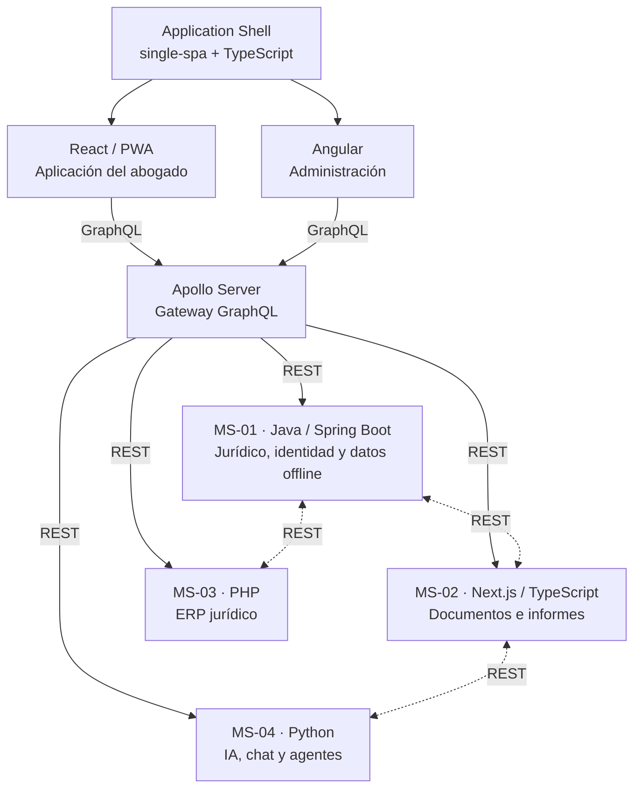

*Figura 1. Arquitectura lógica y límites de los cuatro microservicios.*

| **Servicio**                 | **Responsabilidad**                                                                                                         | **Casos de uso**            |
|------------------------------|-----------------------------------------------------------------------------------------------------------------------------|-----------------------------|
| MS-01 · Java / Spring Boot   | Identidad, personas, expedientes, participantes, actuaciones, notas y suministro jurídico para descargas offline.           | CU-01 a CU-06, CU-08, CU-16 |
| MS-02 · Next.js / TypeScript | Documentos y fotografías, informes históricos fechados, exportaciones y suministro de estos recursos para descarga offline. | CU-07, CU-08, CU-11         |
| MS-03 · PHP                  | Servicios jurídicos, honorarios, cobros, gastos y panel económico.                                                          | CU-12 a CU-15               |
| MS-04 · Python | Agentes Penalista y Civilista, conversaciones y análisis OpenAI con herramientas internas; MCP diferido. | CU-10, CU-17 |
| React / PWA                  | Interfaz del abogado; descarga, eliminación y consulta local de expedientes e informes guardados en modo solo lectura.      | CU-08 y CU-09               |
| Angular                      | Panel exclusivo de administración.                                                                                          | CU-16 y CU-17 (interfaz)    |
| Apollo GraphQL               | Fachada tipada para React y Angular, sin reglas de negocio propias.                                                         | Transversal                 |

### 3.1 Modelo de dominio conceptual (UML de clases)

El modelo describe conceptos y asociaciones necesarios para los casos de uso, sin imponer clases de implementación. Los informes guardados son entidades históricas asociadas a un expediente; pueden copiarse para consulta offline, pero no pasan a ser documentos fuente ni contexto de IA.

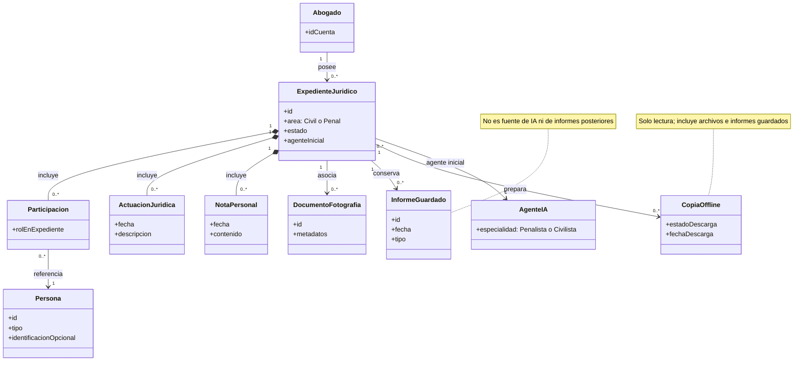

*Figura 2. Modelo conceptual UML: expediente, documentos, informes y copia offline.*

### 3.2 Persistencia por responsabilidad

| **Tecnología**             | **Uso previsto**                                                                                                                           | **Principio de propiedad**                                                                                  |
|----------------------------|--------------------------------------------------------------------------------------------------------------------------------------------|-------------------------------------------------------------------------------------------------------------|
| PostgreSQL                 | Java conserva datos jurídicos; PHP registra información ERP. Next.js puede usar su propio esquema o base lógica para metadatos e informes. | Sin tablas compartidas entre servicios; cada servicio accede a su propio conjunto de datos.                 |
| MongoDB                    | Python almacena conversaciones, mensajes y configuraciones de los dos agentes.                                                             | Archivar un expediente elimina conversaciones y estados conversacionales vinculados.                        |
| Amazon DynamoDB            | Java registra eventos de acceso, intentos de autenticación y auditoría administrativa.                                                     | Se utiliza para eventos de auditoría; no almacena copias locales de expedientes ni colas de sincronización. |
| Almacenamiento de archivos | Next.js conserva documentos, fotografías e informes descargables en almacenamiento de archivos u objetos.                                  | Los binarios no se duplican obligatoriamente en las tres bases de datos.                                    |

### 3.3 Estados del expediente

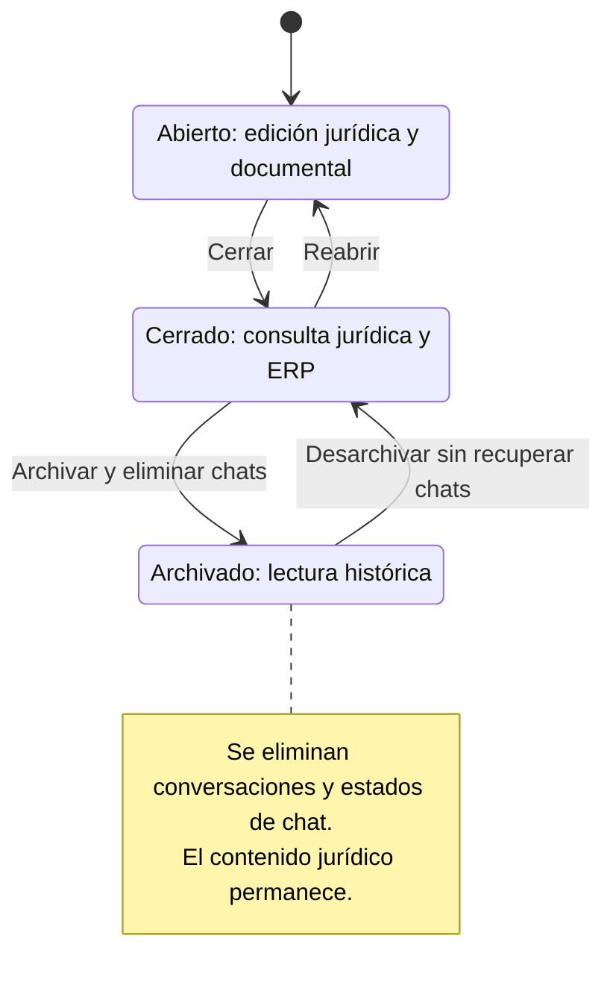

*Figura 3. Diagrama UML de estados; el archivo elimina el historial conversacional.*

| **Operación**                               | **Abierto** | **Cerrado** | **Archivado**               |
|---------------------------------------------|-------------|-------------|-----------------------------|
| Consultar expediente y documentos           | Sí          | Sí          | Sí                          |
| Editar contenido jurídico                   | Sí          | No          | No                          |
| Registrar servicios / actualizar honorarios | Sí          | Sí          | No                          |
| Registrar cobros o gastos                   | Sí          | Sí          | No                          |
| Consultar ERP e informes guardados          | Sí          | Sí          | Sí                          |
| Iniciar o continuar chats                   | Sí          | Sí          | No                          |
| Consultar chats anteriores                  | Sí          | Sí          | No: se eliminan al archivar |
| Consultar copia jurídica descargada         | Sí          | Sí          | Sí (solo lectura)           |

## 4. Casos de uso ICONIX

Cada caso de uso corresponde a un objetivo identificable del actor. En modo offline solo se consultan copias locales, sin escrituras ni cambios pendientes; las llamadas entre microservicios son colaboraciones técnicas, no nuevos casos de uso.

| **ID** | **Caso de uso**                                          | **Actor**               | **Responsable principal** |
|--------|----------------------------------------------------------|-------------------------|---------------------------|
| CU-01  | Autenticarse en el sistema                               | Abogado / Administrador | Java                      |
| CU-02  | Gestionar personas                                       | Abogado                 | Java                      |
| CU-03  | Gestionar expedientes jurídicos                          | Abogado                 | Java                      |
| CU-04  | Gestionar participantes del expediente                   | Abogado                 | Java                      |
| CU-05  | Gestionar actuaciones jurídicas                          | Abogado                 | Java                      |
| CU-06  | Gestionar notas personales                               | Abogado                 | Java                      |
| CU-07  | Gestionar documentos y fotografías                       | Abogado                 | Next.js                   |
| CU-08  | Gestionar descargas de expedientes para consulta offline | Abogado                 | React + Java + Next.js    |
| CU-09  | Consultar expedientes sin conexión                       | Abogado                 | React local               |
| CU-10  | Solicitar asistencia jurídica con IA                     | Abogado                 | Python                    |
| CU-11  | Generar y exportar informes jurídicos                    | Abogado                 | Next.js + Python          |
| CU-12  | Gestionar servicios jurídicos y honorarios               | Abogado                 | PHP                       |
| CU-13  | Gestionar cobros                                         | Abogado                 | PHP                       |
| CU-14  | Gestionar gastos por expediente                          | Abogado                 | PHP                       |
| CU-15  | Consultar panel económico                                | Abogado                 | PHP                       |
| CU-16  | Administrar la aplicación                                | Administrador           | Java                      |
| CU-17  | Gestionar agentes de IA                                  | Administrador           | Python                    |

### 4.1 Diagramas UML de casos de uso

*Nota de representación:* Mermaid no dispone de un diagrama de casos de uso UML nativo; los actores y objetivos se expresan como un diagrama de relaciones (`flowchart`) con nodos de caso de uso. Los diagramas de robustez ICONIX usan nodos identificados explícitamente como `«boundary»`, `«control»` y `«entity»`. Se conservan las relaciones y el significado, aunque la forma gráfica puede variar respecto a UML formal.

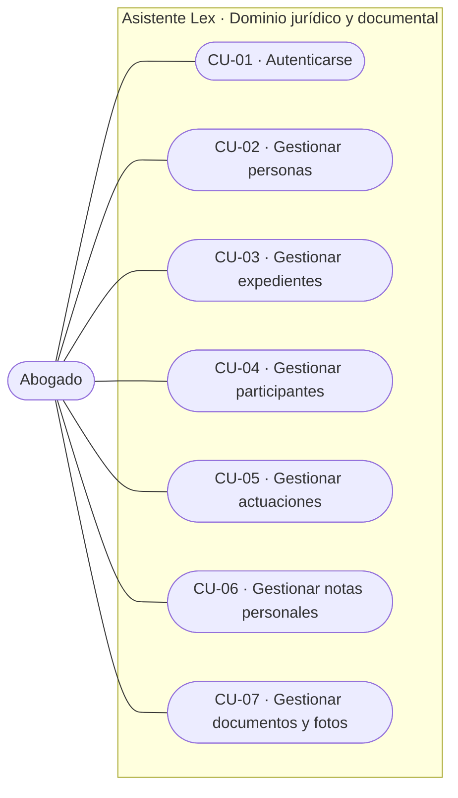

*Figura 4. Casos de uso de gestión jurídica y documental.*

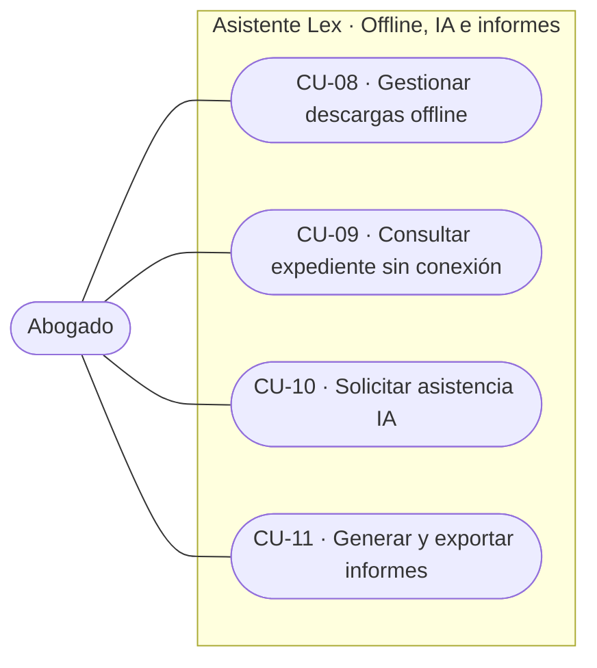

*Figura 5. Casos de uso offline, chat e informes.*

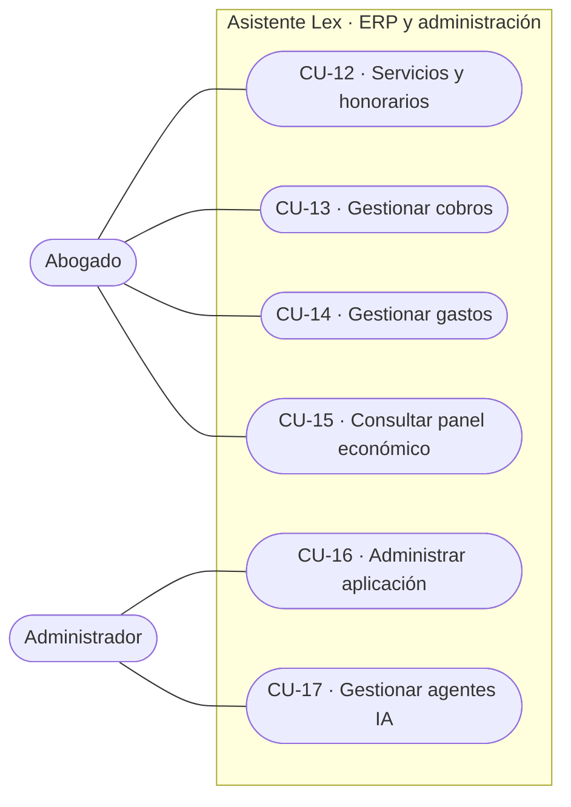

*Figura 6. Casos de uso ERP y administración.*

### 4.2 Especificaciones de los casos de uso

### CU-01 — Autenticarse en el sistema

| **Elemento ICONIX** | **Definición**                                                                                                   |
|---------------------|------------------------------------------------------------------------------------------------------------------|
| Actor principal     | Abogado / Administrador                                                                                          |
| Responsable         | Java                                                                                                             |
| Objetivo            | Acceder a la aplicación según identidad y rol autorizado.                                                        |
| Precondiciones      | Cuenta habilitada.                                                                                               |
| Disparador          | Acceder a Asistente Lex.                                                                                         |
| Flujo principal     | El actor inicia sesión; el sistema valida identidad y rol; presenta la interfaz React o Angular correspondiente. |
| Flujos alternativos | Finalizar sesión; cambiar contraseña propia; restablecimiento por Administrador. SSO diferido. |
| Excepciones         | Credenciales inválidas, cuenta suspendida o acceso no autorizado.                                                |
| Postcondiciones     | Sesión autorizada o rechazo informado.                                                                           |

### CU-02 — Gestionar personas

| **Elemento ICONIX** | **Definición**                                                                                                          |
|---------------------|-------------------------------------------------------------------------------------------------------------------------|
| Actor principal     | Abogado                                                                                                                 |
| Responsable         | Java                                                                                                                    |
| Objetivo            | Administrar fichas de personas naturales y jurídicas del abogado.                                                       |
| Precondiciones      | Abogado autenticado.                                                                                                    |
| Disparador          | Seleccionar Personas.                                                                                                   |
| Flujo principal     | Selecciona tipo; registra nombres y apellidos o razón social; agrega identificación si la conoce; confirma el registro. |
| Flujos alternativos | Consultar, buscar, filtrar y actualizar datos; completar identificación posteriormente.                                 |
| Excepciones         | Documento ya registrado en la cuenta bajo el mismo tipo y país emisor.                                                  |
| Postcondiciones     | Ficha disponible sin exigir un número de identidad.                                                                     |

### CU-03 — Gestionar expedientes jurídicos

| **Elemento ICONIX** | **Definición**                                                                                                                             |
|---------------------|--------------------------------------------------------------------------------------------------------------------------------------------|
| Actor principal     | Abogado                                                                                                                                    |
| Responsable         | Java                                                                                                                                       |
| Objetivo            | Crear y gestionar carpetas jurídicas y transiciones de estado.                                                                             |
| Precondiciones      | Abogado autenticado; existe al menos un agente habilitado.                                                                                 |
| Disparador          | Seleccionar Expedientes.                                                                                                                   |
| Flujo principal     | Ingresa código interno, título, descripción y área Civil/Penal; elige Penalista o Civilista habilitado; confirma la creación como Abierto. |
| Flujos alternativos | Consultar, filtrar y editar expedientes Abiertos; cerrar, reabrir, archivar o desarchivar según transición permitida.                      |
| Excepciones         | Faltan datos, agente deshabilitado, transición inválida o error de eliminación de chat al archivar.                                        |
| Postcondiciones     | Expediente creado o actualizado; al archivar se elimina historial de chats y no se recupera al desarchivar.                                |

### CU-04 — Gestionar participantes del expediente

| **Elemento ICONIX** | **Definición**                                                                            |
|---------------------|-------------------------------------------------------------------------------------------|
| Actor principal     | Abogado                                                                                   |
| Responsable         | Java                                                                                      |
| Objetivo            | Relacionar personas con un expediente y definir su rol contextual.                        |
| Precondiciones      | Persona registrada; expediente Abierto para cambios.                                      |
| Disparador          | Abrir Participantes.                                                                      |
| Flujo principal     | Selecciona persona registrada y expediente; asigna rol jurídico; confirma la vinculación. |
| Flujos alternativos | Consultar, actualizar rol o desvincular participante mientras esté Abierto.               |
| Excepciones         | Persona inexistente, relación incompatible o expediente no editable.                      |
| Postcondiciones     | Relación del participante reflejada en el expediente.                                     |

### CU-05 — Gestionar actuaciones jurídicas

| **Elemento ICONIX** | **Definición**                                                                                                     |
|---------------------|--------------------------------------------------------------------------------------------------------------------|
| Actor principal     | Abogado                                                                                                            |
| Responsable         | Java                                                                                                               |
| Objetivo            | Registrar actuaciones jurídicas y mantener su cronología separada de las notas personales.                         |
| Precondiciones      | Expediente Abierto para alta o corrección.                                                                         |
| Disparador          | Abrir Actuaciones.                                                                                                 |
| Flujo principal     | Selecciona expediente; indica tipo, fecha y descripción; confirma; la actuación aparece en la cronología jurídica. |
| Flujos alternativos | Consultar, filtrar y corregir actuaciones con trazabilidad.                                                        |
| Excepciones         | Datos incompletos o expediente Cerrado/Archivado para escritura.                                                   |
| Postcondiciones     | Actuación incorporada a la cronología.                                                                             |

### CU-06 — Gestionar notas personales

| **Elemento ICONIX** | **Definición**                                                                                                  |
|---------------------|-----------------------------------------------------------------------------------------------------------------|
| Actor principal     | Abogado                                                                                                         |
| Responsable         | Java                                                                                                            |
| Objetivo            | Administrar apuntes personales del abogado sin confundirlos con actuaciones.                                    |
| Precondiciones      | Expediente Abierto para alta o corrección; conexión disponible para modificaciones.                             |
| Disparador          | Abrir Notas personales.                                                                                         |
| Flujo principal     | Selecciona expediente; redacta la nota con conexión; confirma y consulta el registro privado con fecha.         |
| Flujos alternativos | Buscar, consultar y corregir notas con conexión; verlas sin conexión si forman parte de una descarga preparada. |
| Excepciones         | Expediente Cerrado/Archivado para escritura o conexión no disponible al registrar.                              |
| Postcondiciones     | Nota privada independiente de actuaciones, excluida de toda IA y conservada sin historial de versiones. |

### CU-07 — Gestionar documentos y fotografías

| **Elemento ICONIX** | **Definición**                                                                                                                               |
|---------------------|----------------------------------------------------------------------------------------------------------------------------------------------|
| Actor principal     | Abogado                                                                                                                                      |
| Responsable         | Next.js                                                                                                                                      |
| Objetivo            | Adjuntar, clasificar y consultar documentos y fotografías existentes.                                                                        |
| Precondiciones      | Expediente Abierto y conexión para nuevas cargas; acceso autorizado.                                                                         |
| Disparador          | Abrir Documentos.                                                                                                                            |
| Flujo principal     | Elige documento o fotografía preexistente; con conexión verifica estado jurídico; registra archivo y metadatos; confirma.                    |
| Flujos alternativos | Consultar/filtrar por metadatos, visualizar, reclasificar o eliminar en Abierto con conexión y confirmación; copias locales son independientes. |
| Excepciones         | Archivo inválido, carga interrumpida, falta de conexión para adjuntar o expediente sin permiso de escritura.                                 |
| Postcondiciones     | Archivo registrado y asociado al expediente, o consultado sin cambios si se está offline.                                                    |

### CU-08 — Gestionar descargas de expedientes para consulta offline

| **Elemento ICONIX** | **Definición**                                                                                                                                                                                                 |
|---------------------|----------------------------------------------------------------------------------------------------------------------------------------------------------------------------------------------------------------|
| Actor principal     | Abogado                                                                                                                                                                                                        |
| Responsable         | React + Java + Next.js                                                                                                                                                                                         |
| Objetivo            | Preparar, actualizar y retirar copias completas de expedientes para consulta sin conexión, incluyendo informes ya guardados.                                                                                   |
| Precondiciones      | Conexión para descargar o actualizar; expediente autorizado y espacio local suficiente.                                                                                                                        |
| Disparador          | El abogado activa Disponible sin conexión, Actualizar descarga o Eliminar descarga.                                                                                                                            |
| Flujo principal     | Selecciona expediente; React solicita a Java la información jurídica y a Next.js documentos, fotografías e informes previamente guardados con sus fechas; comprueba integridad; marca Disponible sin conexión. |
| Flujos alternativos | Actualizar copia a petición del abogado; descargar expedientes adicionales; retirar copia íntegra local sin tocar datos remotos; expediente sin informes guardados continúa siendo descargable.                |
| Excepciones         | Conectividad ausente para descargar, almacenamiento insuficiente, archivo o informe no recuperable: indicar descarga incompleta y no habilitarla como íntegra.                                                 |
| Postcondiciones     | Copia local de solo lectura con documentos e informes guardados disponible, actualizada o eliminada expresamente.                                                                                              |

### CU-09 — Consultar expedientes sin conexión

| **Elemento ICONIX** | **Definición**                                                                                                                                                                           |
|---------------------|------------------------------------------------------------------------------------------------------------------------------------------------------------------------------------------|
| Actor principal     | Abogado                                                                                                                                                                                  |
| Responsable         | React local                                                                                                                                                                              |
| Objetivo            | Consultar sin conexión expedientes descargados, incluidos los informes guardados vinculados y sus fechas, en solo lectura.                                                               |
| Precondiciones      | Copia local íntegra y disponible en el dispositivo.                                                                                                                                      |
| Disparador          | Abrir un expediente previamente descargado sin conexión.                                                                                                                                 |
| Flujo principal     | Selecciona expediente local; consulta ficha, personas, participantes, actuaciones, notas, documentos, fotografías e informes guardados con fecha; puede abrir cada informe sin conexión. |
| Flujos alternativos | Navegar entre secciones e informes descargados; consultar copia de expediente Cerrado o Archivado; eliminar la copia desde Gestión de descargas.                                         |
| Excepciones         | Copia inexistente o incompleta, archivo de informe local inaccesible; no se permite generar nuevos informes ni chatear sin conexión.                                                     |
| Postcondiciones     | Consulta local terminada sin crear ni modificar datos ni iniciar sincronización de cambios.                                                                                              |

### CU-10 — Solicitar asistencia jurídica con IA

| **Elemento ICONIX** | **Definición**                                                                                                                                 |
|---------------------|------------------------------------------------------------------------------------------------------------------------------------------------|
| Actor principal     | Abogado                                                                                                                                        |
| Responsable         | Python                                                                                                                                         |
| Objetivo            | Conversar con IA especializada y analizar información jurídica autorizada.                                                                     |
| Precondiciones      | Conectividad, agente habilitado y expediente Abierto o Cerrado.                                                                                |
| Disparador          | Abrir pestaña Chat.                                                                                                                            |
| Flujo principal     | Selecciona expediente elegible; se activa inicialmente su agente; envía pregunta; Python devuelve respuesta completa con referencia al agente. |
| Flujos alternativos | Cambiar a Penalista o Civilista dentro del chat conservando el historial; analizar documento o expediente completo.                            |
| Excepciones         | Agente deshabilitado visible/no seleccionable, expediente Archivado no elegible, respuesta temporalmente indisponible.                         |
| Postcondiciones     | Conversación registrada y etiquetada por agente; archivarla elimina el historial asociado.                                                     |

### CU-11 — Generar y exportar informes jurídicos

| **Elemento ICONIX** | **Definición**                                                                                                                                                                                                              |
|---------------------|-----------------------------------------------------------------------------------------------------------------------------------------------------------------------------------------------------------------------------|
| Actor principal     | Abogado                                                                                                                                                                                                                     |
| Responsable         | Next.js + Python                                                                                                                                                                                                            |
| Objetivo            | Generar, guardar, consultar y descargar informes jurídicos, sin incorporarlos como fuentes de futuras respuestas de IA.                                                                                                     |
| Precondiciones      | Expediente y fuentes autorizadas; conexión para generar con IA.                                                                                                                                                             |
| Disparador          | El abogado solicita generar o consultar un informe.                                                                                                                                                                         |
| Flujo principal     | Selecciona expediente y tipo de informe; Next.js obtiene las fuentes jurídicas permitidas, Python propone contenido, Next.js estructura, guarda resultado y fecha, y lo presenta al abogado.                                |
| Flujos alternativos | Resumen ejecutivo one-pager, informe para cliente, reporte en lenguaje natural; consultar y descargar informes históricos; exportar datos tabulares a CSV; incluir informes ya guardados en una descarga offline posterior. |
| Excepciones         | Fuentes insuficientes, error de generación o intento de incluir notas internas en un informe para cliente.                                                                                                                  |
| Postcondiciones     | Informe fechado consultable y descargable en línea, o offline si se preparó una copia del expediente; nunca es fuente de IA ni de informes posteriores.                                                                     |

### CU-12 — Gestionar servicios jurídicos y honorarios

| **Elemento ICONIX** | **Definición**                                                                                             |
|---------------------|------------------------------------------------------------------------------------------------------------|
| Actor principal     | Abogado                                                                                                    |
| Responsable         | PHP                                                                                                        |
| Objetivo            | Registrar servicios contratados y honorarios por expediente.                                               |
| Precondiciones      | Cliente registrado y expediente Abierto o Cerrado.                                                         |
| Disparador          | Abrir Servicios.                                                                                           |
| Flujo principal     | Selecciona expediente y contratante; describe servicio; establece monto BOB y modalidad de pago; confirma. |
| Flujos alternativos | Varios servicios por expediente; consultar y modificar acuerdos con historial.                             |
| Excepciones         | Expediente Archivado o modificación económica incompatible con cobros existentes.                          |
| Postcondiciones     | Servicio registrado con condiciones económicas propias.                                                    |

### CU-13 — Gestionar cobros

| **Elemento ICONIX** | **Definición**                                                                                                                                   |
|---------------------|--------------------------------------------------------------------------------------------------------------------------------------------------|
| Actor principal     | Abogado                                                                                                                                          |
| Responsable         | PHP                                                                                                                                              |
| Objetivo            | Registrar cobros parciales y completos y consultar saldos.                                                                                       |
| Precondiciones      | Servicio asociado a expediente Abierto o Cerrado.                                                                                                |
| Disparador          | Seleccionar Registrar cobro.                                                                                                                     |
| Flujo principal     | Indica importe BOB, fecha y medio; PHP consulta estado de expediente al solicitar operación; registra cobro y estado observado; recalcula saldo. |
| Flujos alternativos | Consultar historial; registrar pago parcial o total; corregir con trazabilidad.                                                                  |
| Excepciones         | Expediente Archivado; importe no positivo, precisión inválida o superior al saldo. No hay control de duplicados. |
| Postcondiciones     | Cobro confirmado con estado del expediente observado al solicitarlo.                                                                             |

### CU-14 — Gestionar gastos por expediente

| **Elemento ICONIX** | **Definición**                                                                                                            |
|---------------------|---------------------------------------------------------------------------------------------------------------------------|
| Actor principal     | Abogado                                                                                                                   |
| Responsable         | PHP                                                                                                                       |
| Objetivo            | Registrar y consultar gastos asociados a expedientes.                                                                     |
| Precondiciones      | Expediente Abierto o Cerrado.                                                                                             |
| Disparador          | Seleccionar Nuevo gasto.                                                                                                  |
| Flujo principal     | Elige expediente; indica concepto, categoría, fecha e importe BOB; consulta estado y registra gasto con estado observado. |
| Flujos alternativos | Consultar, filtrar y corregir gastos con trazabilidad.                                                                    |
| Excepciones         | Expediente Archivado o importe inválido/no positivo. No hay control de duplicados. |
| Postcondiciones     | Gasto confirmado, separado de cobros y saldos.                                                                            |

### CU-15 — Consultar panel económico

| **Elemento ICONIX** | **Definición**                                                                             |
|---------------------|--------------------------------------------------------------------------------------------|
| Actor principal     | Abogado                                                                                    |
| Responsable         | PHP                                                                                        |
| Objetivo            | Consultar la situación económica profesional por expediente y período.                     |
| Precondiciones      | Abogado autenticado.                                                                       |
| Disparador          | Abrir Panel económico.                                                                     |
| Flujo principal     | Selecciona expediente completo con saldo pendiente o período de toda cuenta con balance temporal; muestra honorarios, cobros y gastos separados. |
| Flujos alternativos | Abrir detalle de movimientos; exportar resultados tabulares a CSV.                         |
| Excepciones         | No hay registros o el período no es válido.                                                |
| Postcondiciones     | Consulta sin modificar movimientos.                                                        |

### CU-16 — Administrar la aplicación

| **Elemento ICONIX** | **Definición**                                                                                              |
|---------------------|-------------------------------------------------------------------------------------------------------------|
| Actor principal     | Administrador                                                                                               |
| Responsable         | Java                                                                                                        |
| Objetivo            | Administrar cuentas, parámetros y eventos administrativos.                                                  |
| Precondiciones      | Administrador autenticado.                                                                                  |
| Disparador          | Abrir Administración en Angular.                                                                            |
| Flujo principal     | Consulta/crea/reactiva/suspende cuentas o restablece contraseña; ajusta mensaje global/correo de soporte; intenta registrar auditoría. |
| Flujos alternativos | Consultar eventos: accesos, fallos, cierres, denegaciones y cambios administrativos.                        |
| Excepciones         | Permisos insuficientes o cuenta inexistente.                                                                |
| Postcondiciones     | Cambio aplicado y auditado o resultado parcial explícito si falla registrar el evento; sin cola de recuperación. |

### CU-17 — Gestionar agentes de IA

| **Elemento ICONIX** | **Definición**                                                                                |
|---------------------|-----------------------------------------------------------------------------------------------|
| Actor principal     | Administrador                                                                                 |
| Responsable         | Python                                                                                        |
| Objetivo            | Gestionar la configuración y habilitación de Penalista y Civilista.                           |
| Precondiciones      | Administrador autenticado.                                                                    |
| Disparador          | Abrir catálogo de agentes en Angular.                                                         |
| Flujo principal     | Consulta agentes; modifica instrucciones, modelo OpenAI libre, herramientas internas o habilitación; confirma y comunica auditoría o fallo parcial. |
| Flujos alternativos | Revisar configuración e historial; deshabilitar/rehabilitar.                                  |
| Excepciones         | Un agente deshabilitado aparece en catálogo, pero no acepta nuevas consultas.                 |
| Postcondiciones     | Configuración vigente de los dos agentes, sin acceso a conversaciones privadas.               |

## 5. Análisis ICONIX: robustez y secuencia de casos clave

Los diagramas de robustez identifican objetos de frontera («boundary»), control («control») y entidad («entity») entre el caso de uso textual y las interacciones. Los diagramas de secuencia muestran la colaboración entre actores y servicios; no se elaboran diagramas de actividad para autenticación ni operaciones CRUD genéricas.

### 5.1 CU-03 — Archivo y eliminación de conversaciones

El archivo solo parte del estado Cerrado. El expediente pasa a Archivado con eliminación de chats y estados de conversación; desarchivar conduce a Cerrado sin recuperar conversaciones.

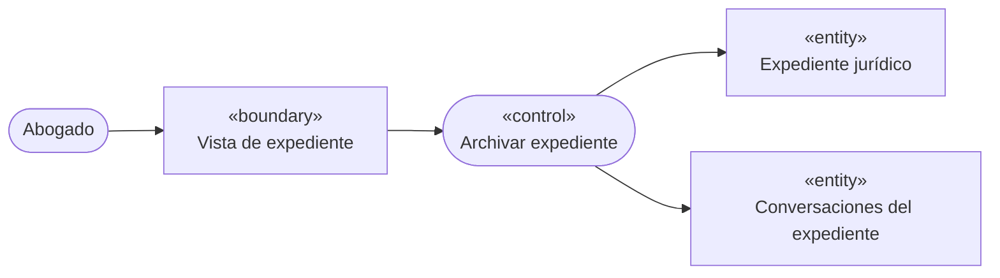

*Figura 7. Diagrama UML de robustez — CU-03.*

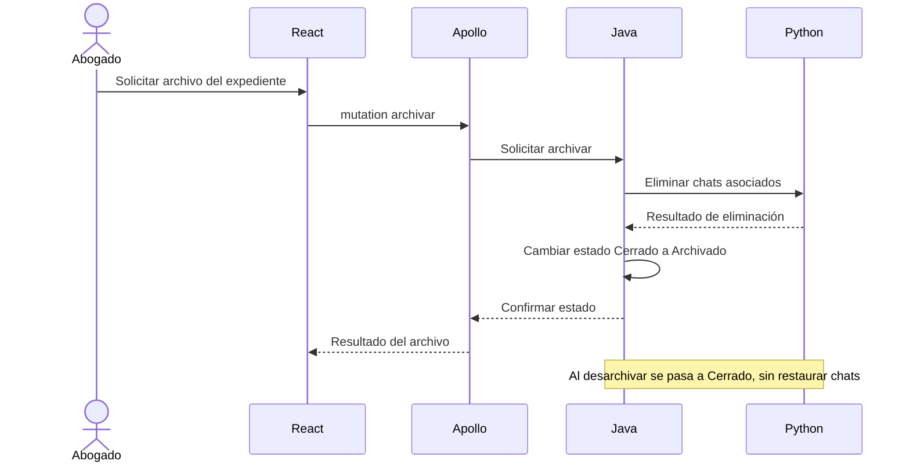

*Figura 8. Diagrama UML de secuencia — CU-03.*

### 5.2 CU-08 — Preparación de expediente e informes offline

La copia se prepara con información de Java, documentos, fotografías e informes previamente guardados suministrados por Next.js. Los informes se conservan con fecha, pero nunca se usan como fuentes para IA o informes nuevos.

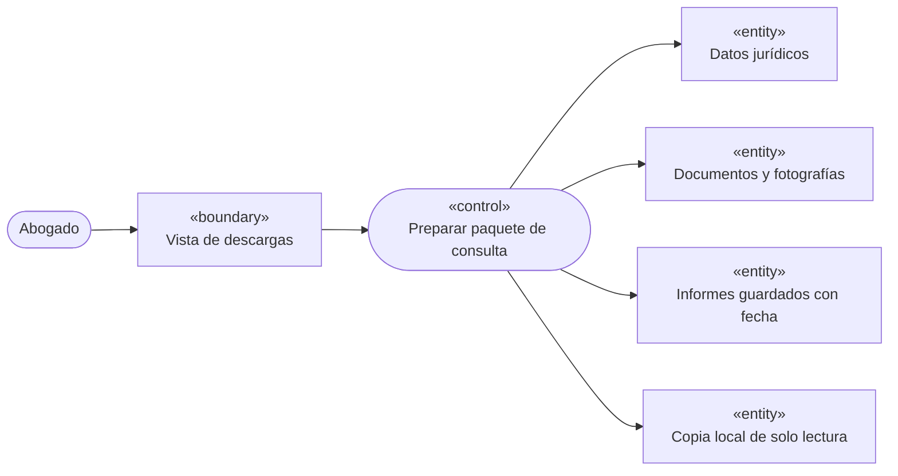

*Figura 9. Diagrama UML de robustez — CU-08.*

```mermaid
sequenceDiagram
    actor Abogado
    participant React as React / PWA
    participant Apollo
    participant Java
    participant Next as Next.js
    participant Local as Copia local
    Abogado->>React: Seleccionar expediente
    React->>Apollo: Solicitar datos completos
    Apollo->>Java: Leer ficha y actuaciones
    Java-->>Apollo: Datos jurídicos permitidos
    React->>Apollo: Solicitar archivos e informes
    Apollo->>Next: Leer documentos, fotos e informes
    Next-->>Apollo: Archivos, fechas y metadatos
    Apollo-->>React: Recursos descargables
    React->>Local: Guardar paquete de solo lectura
    React->>React: Comprobar integridad y habilitar consulta
    Note over React,Local: Sin ERP ni chats; los informes guardados sí se incluyen
```

*Figura 10. Diagrama UML de secuencia — CU-08.*

### 5.3 CU-11 — Generación y conservación de informes

El informe para cliente excluye información interna. El resultado generado se guarda como informe histórico fechado y puede incorporarse a una descarga futura, sin incorporarlo como documento fuente.

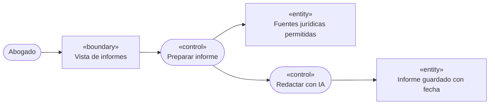

*Figura 11. Diagrama UML de robustez — CU-11.*

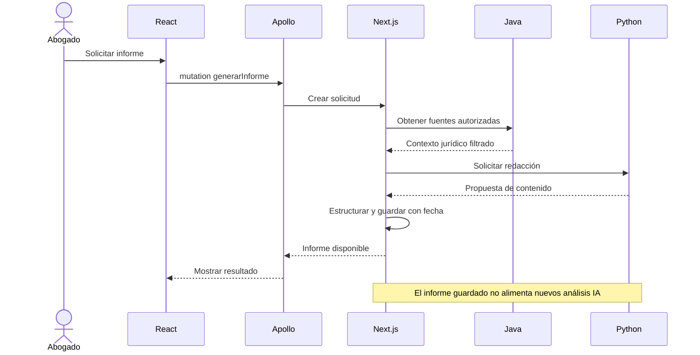

*Figura 12. Diagrama UML de secuencia — CU-11.*

### 5.4 CU-13 — Registro de cobro con estado observado

PHP consulta el estado del expediente al solicitar el cobro, admite Abierto/Cerrado y registra el estado observado sin prometer coincidencia atómica frente a cambios posteriores.

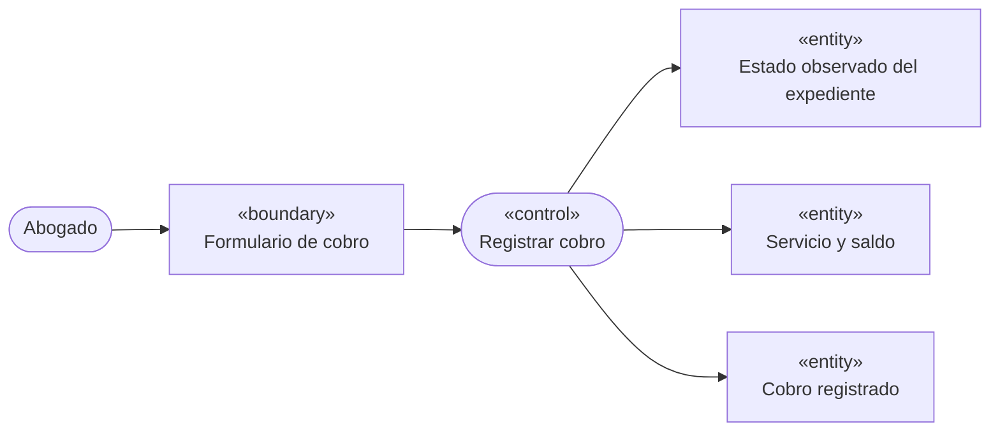

*Figura 13. Diagrama UML de robustez — CU-13.*

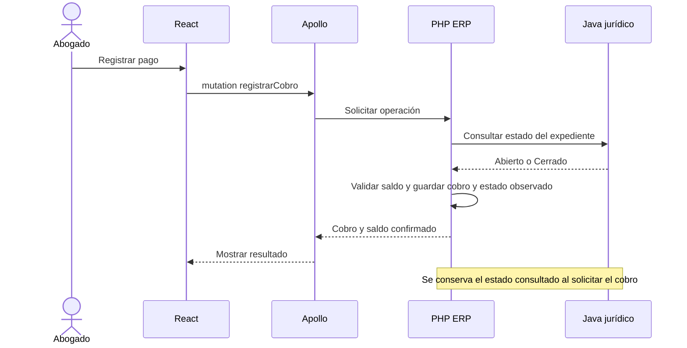

*Figura 14. Diagrama UML de secuencia — CU-13.*

## 6. Actividades de negocio y reglas transversales

### 6.1 Descarga y consulta offline de solo lectura

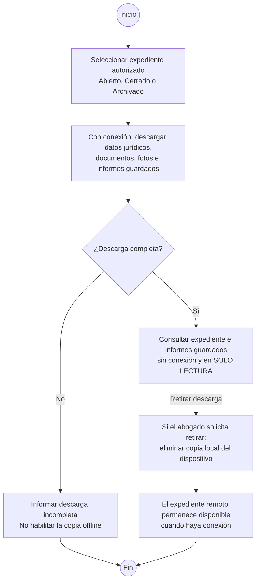

*Figura 15. Actividad UML: descarga íntegra, incluyendo informes guardados, consulta en solo lectura y eliminación local.*

La descarga solicitada por el abogado incluye los datos jurídicos completos admitidos, documentos, fotografías e informes previamente guardados asociados al expediente, con fecha y metadatos. Excluye ERP y conversaciones de IA. La copia local es de solo lectura: no permite modificar datos, generar informes, iniciar chats ni adjuntar archivos. Los informes históricos permanecen excluidos como fuentes de IA y de nuevos informes. El abogado puede eliminar la descarga completa en su dispositivo sin afectar el original remoto y actualizarla cuando vuelva a tener conexión.

### 6.2 Generación y conservación de informes

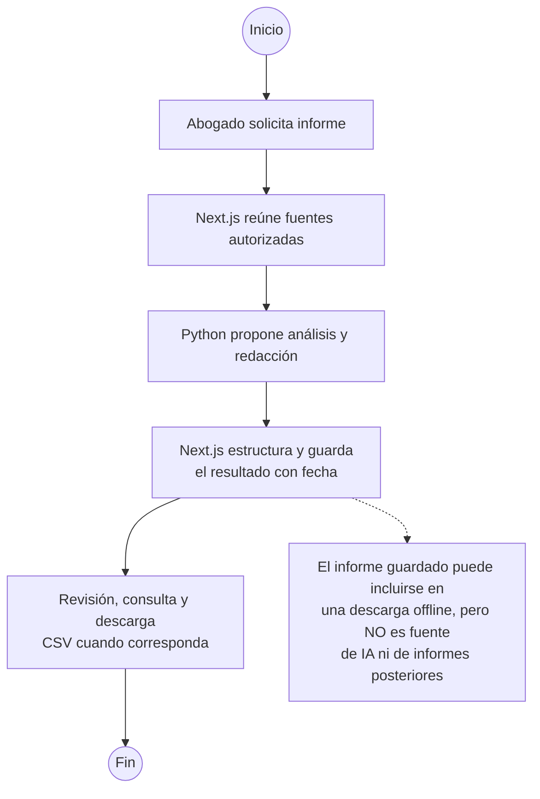

*Figura 16. Actividad UML: informes fechados, descargables offline y excluidos como fuentes futuras.*

Se contemplan el resumen ejecutivo (one-pager), el informe para cliente en lenguaje claro y reportes mediante lenguaje natural. Los resultados tabulares pueden exportarse a CSV. Cada informe se guarda con su fecha, puede visualizarse y descargarse, y se incluye en copias offline del expediente preparadas después de guardarlo. No se convierte en documento jurídico original ni en fuente de IA o de informes futuros.

### 6.3 Coordinación de operaciones entre servicios

Java conserva la decisión de escritura sobre expedientes y Next.js administra sus archivos. PHP registra un cobro o gasto tomando el estado del expediente consultado al solicitar el movimiento. Python consume información jurídica y documental autorizada, mientras Next.js gestiona el resultado documental de los informes. Las comunicaciones de servicio no modifican los límites del caso de uso del actor.

## 7. Matriz de trazabilidad

| **CU** | **Objetivo funcional**                                   | **Responsable**        | **Requisitos relacionados**            |
|--------|----------------------------------------------------------|------------------------|----------------------------------------|
| CU-01  | Autenticarse en el sistema                               | Java                   | RF-001                                 |
| CU-02  | Gestionar personas                                       | Java                   | RF-002, RF-003                         |
| CU-03  | Gestionar expedientes jurídicos                          | Java                   | RF-004, RF-005, RF-006, RF-007         |
| CU-04  | Gestionar participantes del expediente                   | Java                   | RF-008                                 |
| CU-05  | Gestionar actuaciones jurídicas                          | Java                   | RF-009                                 |
| CU-06  | Gestionar notas personales                               | Java                   | RF-010                                 |
| CU-07  | Gestionar documentos y fotografías                       | Next.js                | RF-011, RF-012                         |
| CU-08  | Gestionar descargas de expedientes para consulta offline | React + Java + Next.js | RF-013, RF-014                         |
| CU-09  | Consultar expedientes sin conexión                       | React local            | RF-015                                 |
| CU-10  | Solicitar asistencia jurídica con IA                     | Python                 | RF-007, RF-016, RF-017, RF-018, RF-032 |
| CU-11  | Generar y exportar informes jurídicos                    | Next.js + Python       | RF-019, RF-020, RF-021, RF-022         |
| CU-12  | Gestionar servicios jurídicos y honorarios               | PHP                    | RF-023, RF-024, RF-027                 |
| CU-13  | Gestionar cobros                                         | PHP                    | RF-025, RF-027                         |
| CU-14  | Gestionar gastos por expediente                          | PHP                    | RF-026, RF-027                         |
| CU-15  | Consultar panel económico                                | PHP                    | RF-022, RF-028                         |
| CU-16  | Administrar la aplicación                                | Java                   | RF-029, RF-030                         |
| CU-17  | Gestionar agentes de IA                                  | Python                 | RF-031, RF-032                         |

Los diagramas de robustez y secuencia se concentran en CU-03, CU-08, CU-11 y CU-13, por contener reglas específicas de archivado, preparación offline, elaboración documental o registro económico. Los diagramas de actividad se limitan a CU-08 y CU-11.

## 8. Aclaraciones: capacidades previstas fuera del MVP

Las siguientes capacidades forman parte de la visión del proyecto, pero no se incluyen como funcionalidades implementables en esta primera entrega. Su diseño funcional, alcance y criterios de aceptación se definirán cuando se planifiquen las siguientes fases:

| **Capacidad diferida**            | **Alcance futuro previsto**                                                                                                                       |
|-----------------------------------|---------------------------------------------------------------------------------------------------------------------------------------------------|
| Machine Learning / Deep Learning  | Modelos propios o especializados, incluidos enfoques supervisados y no supervisados; no se entrenarán ni ejecutarán como parte del MVP.           |
| IA local sin conexión             | Ejecución de modelos de inteligencia artificial directamente en dispositivos o cliente web, diferenciada de la consulta convencional offline.     |
| TensorFlow y procesamiento visual | Procesamiento de imágenes o video en tiempo real y funcionalidades visuales basadas en modelos. El MVP solo adjunta fotografías preexistentes.    |
| Automatización end-to-end         | Flujos autónomos de negocio que ejecuten y coordinen procesos completos sin intervención continua del abogado; su especificación queda pendiente. |

Estas exclusiones no afectan agentes remotos Penalista/Civilista con herramientas internas autorizadas, informes solicitados por el abogado, CSV y descarga jurídica de solo lectura. SSO y MCP, incluidas conexiones personales, se difieren expresamente de esta fase.

FIN DEL DOCUMENTO — ASISTENTE LEX · v1.3.0
