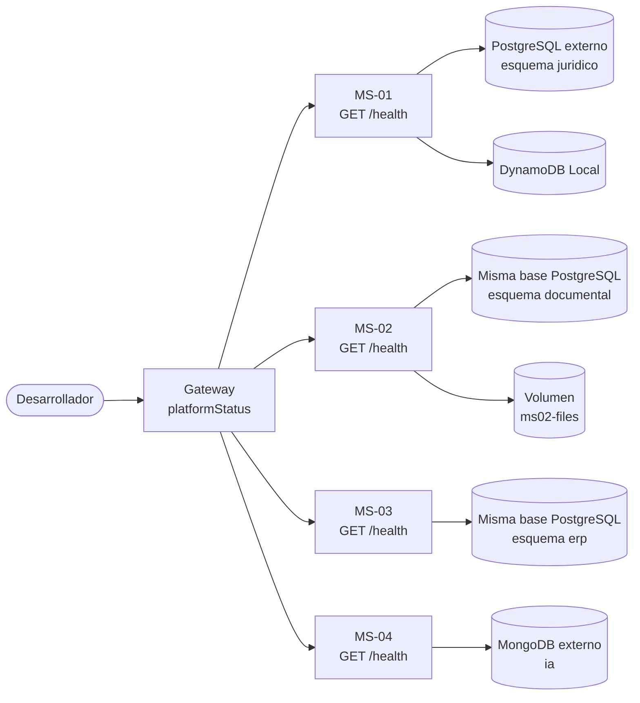

# Plan: Plataforma base

## Estado

En progreso; adaptación a bases externas pendiente de verificación.

## Resumen técnico

Se crea un monorepo con una carpeta por componente dentro de `src/` y un entorno local definido con Docker Compose en la raíz.

- **Almacenes:** PostgreSQL externo 18.x contiene una base y tres esquemas (`juridico`, `documental`, `erp`) con un usuario compartido; MongoDB externo sirve a MS-04 mediante URI; DynamoDB Local permanece en Docker. Un volumen exclusivo de MS-02 emula sus archivos.
- **Microservicios:** cuatro esqueletos sin lógica de negocio, cada uno con la estructura en capas de la constitución y un endpoint técnico `GET /health` con un contrato común que informa el estado de sus almacenes.
- **Gateway:** Apollo Server expone una consulta técnica `platformStatus` que consulta en paralelo la salud de los cuatro servicios, con tiempo de espera.
- **Frontend:** un Application Shell con single-spa monta el microfrontend React en `/abogado` y el Angular en `/admin`, ambos con contenido provisional.

Toda la configuración se lee de variables de entorno. Los secretos no se versionan. La documentación de la raíz explica cómo preparar, ejecutar y comprobar el entorno, tanto con Docker Compose como ejecutando un componente directamente.

Este plan satisface los requisitos de la [spec](./spec.md) sin introducir entidades ni reglas de negocio.

## Diseño y componentes

### Estructura del repositorio

```text
asistente-lex/
├── compose.yaml                    # Entorno local completo
├── .env.example                    # Variables del entorno local con valores ficticios
├── .gitignore                      # Excluye .env, dependencias y artefactos
├── .gitattributes                  # Fuerza LF en scripts de shell
├── README.md                       # Preparación, ejecución y comprobación
├── infra/
│   ├── postgres/bootstrap.sql      # Aprovisionamiento externo con psql 18
│   └── certificates/               # Certificados locales, no versionados
└── src/
    ├── frontend/
    │   ├── shell/                  # Application Shell: single-spa + TypeScript
    │   ├── abogado/                # Microfrontend React
    │   └── admin/                  # Microfrontend Angular
    ├── gateway/                    # Apollo Server (TypeScript)
    └── services/
        ├── ms-01-juridico/         # Java / Spring Boot
        ├── ms-02-documental/       # Next.js / TypeScript
        ├── ms-03-erp/              # PHP / Laravel
        └── ms-04-ia/               # Python / FastAPI
```

Cada componente es un proyecto independiente con sus propias dependencias, `Dockerfile` y `.env.example`. No se comparten dependencias entre componentes, para que cada uno pueda ejecutarse por separado.

### Estructura en capas de los microservicios

Los cuatro servicios usan la misma organización conceptual, adaptada a las convenciones de cada lenguaje:

| Capa | Contenido | Puede depender de |
|---|---|---|
| `domain` | Entidades, objetos de valor y reglas de negocio. Vacía en esta spec. | Nada externo |
| `application` | Casos de uso y puertos de entrada (`ports/in`) y salida (`ports/out`). Vacía en esta spec. | `domain` |
| `adapters/in` | Controladores REST que invocan casos de uso. | `application` |
| `adapters/out` | Implementaciones de los puertos de salida: persistencia y clientes de otros servicios. | `application`, `domain` |
| `infrastructure` | Arranque, configuración, inyección de dependencias y comprobación técnica de salud. | Todas |

La comprobación de salud vive en `infrastructure`, porque es una preocupación técnica y no lógica de negocio. Las capas vacías se conservan en el repositorio con un archivo `.gitkeep`.

Adaptación por servicio:

| Servicio | Ubicación de las capas | Notas |
|---|---|---|
| MS-01 (Spring Boot) | Paquetes `domain`, `application`, `adapters`, `infrastructure` bajo el paquete base del proyecto. | Construcción con Maven. |
| MS-02 (Next.js) | Carpeta `src/` con las cuatro capas. La carpeta `app/` solo contiene manejadores de rutas que delegan en `adapters/in` o `infrastructure`. | Se usa únicamente como servicio REST; no expone páginas. |
| MS-03 (Laravel) | Carpeta `src/` con espacio de nombres propio y las cuatro capas. Las carpetas propias de Laravel actúan como infraestructura. | `domain` y `application` no importan clases de Laravel. |
| MS-04 (FastAPI) | Paquete `app/` con las cuatro capas. La aplicación FastAPI se crea en `infrastructure`. | Dependencias declaradas en `pyproject.toml`. Los puertos y adaptadores de entrada y salida se llaman `inbound` y `outbound`, porque `in` es palabra reservada en Python. |

### Gateway

- Proyecto TypeScript con Apollo Server, integrado con Express 5 mediante `@as-integrations/express5`.
- Organización: `schema/` (definición GraphQL), `resolvers/`, `clients/` (clientes REST de los servicios) y `config/`.
- Node.js 26 ejecuta el TypeScript directamente; `tsc` solo se usa para comprobar tipos.
- No contiene reglas de negocio.
- Lee las URL de los servicios, el tiempo de espera y los orígenes permitidos desde variables de entorno.
- Las solicitudes con un encabezado `Origin` no configurado se rechazan con `403`, en lugar de depender solo del navegador.

### Frontend

- **Shell:** configuración raíz de single-spa en TypeScript. Empaqueta single-spa y sirve SystemJS y su extensión AMD desde su propia carpeta, sin CDN externos. Registra dos aplicaciones mediante un import map por entorno:
  - `abogado` en la ruta `/abogado`.
  - `admin` en la ruta `/admin`.
- **Abogado:** aplicación React integrada con `single-spa-react`, construida con webpack y `esbuild-loader` en formato SystemJS. Muestra un contenido provisional que identifica la aplicación.
- **Admin:** aplicación Angular integrada con `single-spa-angular`, construida con `@angular-builders/custom-webpack` en formato UMD, que SystemJS carga mediante su extensión AMD. Muestra un contenido provisional que identifica la aplicación.
- Los servidores de desarrollo de los frontends escuchan solo en `localhost`.
- La ruta `/` muestra una página provisional con enlaces a ambas rutas, hasta que la spec 003 resuelva la navegación por rol.
- La configuración PWA se aplaza a la spec 013.

### Entorno local

Docker Compose define dos grupos:

- **Almacén local:** `dynamodb-local`, más el volumen `ms02-files`. PostgreSQL y MongoDB son externos y no se despliegan con Compose.
- **Componentes (perfil `app`):** los cuatro servicios, el gateway, el shell y los dos microfrontends.

Uso previsto:

- `docker compose up` levanta solo DynamoDB Local.
- `docker compose --profile app up` levanta el entorno completo.
- Para ejecutar un componente directamente, se detiene su contenedor y se usa su `.env.example`, con la misma conexión externa y su esquema. Las rutas de certificados deben referirse al host, no a `/certs`.

Puertos locales predeterminados, configurables mediante variables de entorno:

| Componente | Puerto |
|---|---|
| Shell | 9000 |
| Microfrontend abogado | 9100 |
| Microfrontend admin | 9200 |
| Gateway | 4000 |
| MS-01 | 8081 |
| MS-02 | 8082 |
| MS-03 | 8083 |
| MS-04 | 8084 |
| DynamoDB Local | 8000 |

Todos los puertos de contenedores se publican solo en `127.0.0.1`. Los puertos externos de PostgreSQL y MongoDB los define el proveedor; no se publican desde Compose.

## Flujo de datos

Esta spec no maneja datos de negocio. El único flujo es la comprobación técnica de disponibilidad:



1. El desarrollador ejecuta `platformStatus` en el gateway, o consulta directamente `GET /health` de un servicio.
2. Cada servicio comprueba sus almacenes asignados con una operación mínima, con tiempo de espera:
   - PostgreSQL: consulta de `current_schema()` sobre la base compartida.
   - DynamoDB Local: listado de tablas.
   - Almacenamiento de archivos: el directorio configurado existe y admite escritura.
   - MongoDB: comando `ping`.
3. El gateway consulta los cuatro servicios en paralelo y agrega los resultados. Un servicio que no responde dentro del tiempo de espera se informa como no disponible, sin hacer fallar la consulta completa.

## Interfaces y contratos

### Salud de cada servicio (REST)

`GET /health`, común a los cuatro servicios.

- `200 OK` cuando el servicio y todos sus almacenes están disponibles.
- `503 Service Unavailable` cuando al menos un almacén no está disponible.

```json
{
  "service": "ms-01-juridico",
  "status": "UP",
  "dependencies": {
    "postgresql": "UP",
    "dynamodb": "UP"
  }
}
```

- `status` y cada dependencia toman los valores `UP` o `DOWN`.
- La respuesta no incluye cadenas de conexión, credenciales ni mensajes de error internos.

Dependencias informadas por cada servicio:

| Servicio | `service` | `dependencies` |
|---|---|---|
| MS-01 | `ms-01-juridico` | `postgresql`, `dynamodb` |
| MS-02 | `ms-02-documental` | `postgresql`, `fileStorage` |
| MS-03 | `ms-03-erp` | `postgresql` |
| MS-04 | `ms-04-ia` | `mongodb` |

### Estado de la plataforma (GraphQL)

```graphql
enum ServiceStatus {
  UP          # El servicio y sus almacenes están disponibles
  DOWN        # El servicio responde, pero algún almacén no está disponible
  UNAVAILABLE # El servicio no responde o excede el tiempo de espera
}

type ServiceHealth {
  name: String!
  status: ServiceStatus!
}

type PlatformStatus {
  services: [ServiceHealth!]!
}

type Query {
  platformStatus: PlatformStatus!
}
```

- Solo informa el estado de cada servicio, no el detalle de sus almacenes, para limitar la información expuesta.
- Es un contrato técnico. La spec 002 definirá las convenciones generales de contratos y podrá ajustarlo.

## Persistencia y migraciones

- **PostgreSQL:** una instancia externa 18.x, una base y tres esquemas, con un usuario común no administrativo. `infra/postgres/bootstrap.sql` se ejecuta con psql y un administrador; admite repetición, no modifica passwords de usuarios existentes y no adopta esquemas de otros propietarios. El nombre de base y usuario son parametrizables.
- Las conexiones seleccionan el esquema con `currentSchema` (JDBC), `search_path` (Laravel) y `set_config` parametrizado (sonda de MS-02). Las comprobaciones de salud verifican `current_schema()` para detectar esquemas ausentes o mal configurados.
- **TLS PostgreSQL:** `DB_SSLMODE=verify-full` y `DB_SSLROOTCERT` en los tres servicios y sus sondas; CA montada desde `infra/certificates` a `/certs`. `disable` solo se admite para desarrollo local sin TLS. Las futuras conexiones de negocio de MS-02 deben reutilizar estas opciones y seleccionar su esquema al abrir la conexión.
- **MongoDB:** base `ia` y usuario limitados por el administrador/proveedor; MS-04 usa `MONGO_URI` completa (incluye authSource, SRV y TLS según proveedor) y `MONGO_DB`. La URI se mantiene como `SecretStr` en su configuración.
- **DynamoDB Local:** configurado solo en MS-01. Esta spec no crea tablas.
- **Almacenamiento de archivos de MS-02:** volumen de Docker `ms02-files`, montado solo en el contenedor de MS-02, en la ruta indicada por la variable `FILE_STORAGE_PATH`. Cuando MS-02 se ejecuta directamente, esa variable apunta a la carpeta local `.data/ms-02-files`, excluida del control de versiones. La primera spec que guarde archivos (010) definirá el puerto de almacenamiento que permitirá sustituir esta emulación por almacenamiento de objetos en otros entornos.
- Cada servicio solo recibe la configuración y credenciales de sus almacenes asignados.
- Solo se crean los tres esquemas contenedores; no tablas, colecciones ni semillas de negocio/demo. Las migraciones y semillas pertenecen a las primeras specs funcionales que creen datos.
- Docker conserva DynamoDB y archivos en volúmenes. Los datos de PostgreSQL y MongoDB son externos. Los antiguos volúmenes locales no se eliminan ni migran automáticamente.

## Seguridad y privacidad

- `.env` está en `.gitignore`. Los archivos `.env.example` solo contienen valores ficticios.
- PostgreSQL usa credenciales compartidas de aplicación por decisión expresa del responsable. La separación por esquemas no impide accesos cruzados; el código sigue obligado a respetar la propiedad de datos. MongoDB conserva un usuario limitado a su base. No se guardan credenciales administrativas en `.env`.
- Los puertos se publican solo en `127.0.0.1`.
- Las respuestas de salud y los registros no incluyen credenciales, cadenas de conexión ni detalles internos de errores.
- El gateway solo admite solicitudes desde los orígenes configurados del shell y los microfrontends (CORS).
- Esta spec no incluye autenticación. Hasta la spec 003, `platformStatus` y `GET /health` son accesibles sin autenticación, solo en el entorno local.

## Observabilidad y manejo de errores

- Cada componente escribe sus registros en la salida estándar, visibles con `docker compose logs`.
- Los registros incluyen el nombre del componente y no contienen secretos.
- Ante un almacén no disponible, `GET /health` responde `503` con la dependencia en `DOWN`, en lugar de fallar sin respuesta.
- Las comprobaciones de almacenes y las llamadas del gateway tienen tiempos de espera configurables, para que una dependencia lenta no bloquee la respuesta.
- El gateway registra los servicios no disponibles con su nombre y el motivo general (tiempo agotado o conexión rechazada), sin detalles sensibles.
- Un servicio no disponible no impide que los demás arranquen. Los componentes no esperan a que todas sus dependencias estén disponibles para iniciar.

## Verificación

El desarrollador comprueba los criterios de aceptación de la spec. No se crean archivos de testing.

| Criterio de la spec | Cómo se verifica |
|---|---|
| Entorno completo desde un clon nuevo | Seguir el `README.md` desde cero y ejecutar `docker compose --profile app up` sin pasos adicionales. |
| Ejecución directa de un componente | Detener un contenedor, ejecutar el componente con su herramienta y comprobar su salud y su aparición en `platformStatus`. |
| Salud de cada servicio | Consultar `GET /health` de los cuatro servicios y obtener `200` con todas las dependencias en `UP`. |
| Almacén detenido | Detener un almacén y comprobar que el servicio afectado responde `503` con esa dependencia en `DOWN`. |
| Montaje de microfrontends | Abrir `/abogado` y `/admin` en el shell y comprobar que se monta la aplicación correspondiente. |
| Conectividad del gateway | Ejecutar `platformStatus` y obtener los cuatro servicios en `UP`. |
| Servicio detenido | Detener un servicio y comprobar que aparece `UNAVAILABLE` y los demás conservan su estado. |
| Estructura en capas | Revisar que `domain` y `application` no importan frameworks ni clientes de persistencia. |
| Propiedad de persistencia | Comprobar base/usuario comunes, `current_schema()` distinto en cada consumidor y volumen de archivos exclusivo de MS-02. Documentar que el usuario puede acceder a los tres esquemas. |
| Aprovisionamiento PostgreSQL | Ejecutar bootstrap dos veces en PostgreSQL 18.x dedicado y comprobar esquemas/propietarios, rol no administrativo y ausencia de tablas/semillas. |
| Sin secretos versionados | Revisar que solo se versionan archivos `.env.example` con valores ficticios. |
| Sin lógica de negocio | Revisar que no existen entidades ni reglas de negocio. |

## Decisiones

Decisiones confirmadas por el responsable del proyecto:

- Monorepo con una carpeta por componente dentro de `src/`.
- Docker Compose para DynamoDB Local y componentes; PostgreSQL y MongoDB externos, con ejecución directa opcional.
- DynamoDB Local como emulador local de DynamoDB.
- Volumen de Docker montado solo en MS-02 para emular el almacenamiento de archivos, porque MinIO dejó de publicar imágenes públicas.
- Una base PostgreSQL con tres esquemas y un usuario compartido; pérdida de aislamiento por permisos aceptada el 2026-11-08.
- Una sola instancia por tecnología de base de datos: PostgreSQL, MongoDB y DynamoDB.
- Laravel para MS-03 y FastAPI para MS-04.
- Versiones LTS o estables vigentes al iniciar la implementación.
- Solo entorno local en esta spec.

Decisiones propuestas en este plan, que se aprueban junto con él:

- Contrato común `GET /health` y consulta técnica `platformStatus`.
- Estructura de carpetas, capas y puertos descritos en este plan.
- Maven para MS-01, npm por proyecto para los componentes JavaScript, Composer para MS-03 y `pyproject.toml` para MS-04.
- Perfil `app` de Docker Compose para los componentes.

ADR relacionados en `docs/decisions/`:

- [ADR 0001: Stack tecnológico y versiones](../../docs/decisions/0001-stack-y-versiones.md). Aceptado; las versiones se fijan en la primera tarea de implementación.
- [ADR 0002: Monorepo y entorno local](../../docs/decisions/0002-monorepo-y-entorno-local.md). Aceptado.
- [ADR 0003: Persistencia por servicio](../../docs/decisions/0003-persistencia-por-servicio.md). Aceptado.

## Riesgos y preguntas abiertas

- **Compatibilidad de Angular con single-spa:** `single-spa-angular` 22.0.1 es compatible con Angular 22, pero su schematic `ng add` falla por un error del propio paquete, así que la integración se configuró manualmente a partir de sus plantillas oficiales. Además depende del constructor webpack de Angular, que Angular marca como obsoleto. Mitigación: revisar las nuevas versiones de `single-spa-angular` al actualizar Angular y migrar cuando admita el constructor `@angular/build`.
- **Tiempo de respuesta de la comprobación de MS-03:** la conexión de Laravel a PostgreSQL no admite `connect_timeout` y reintenta al perder la conexión. Mitigación: la comprobación de salud usa PDO directamente con `connect_timeout`, y el contenedor acorta los reintentos de DNS (`RES_OPTIONS`).
- **DynamoDB Local no aplica permisos:** en local, el aislamiento depende solo de que únicamente MS-01 tenga su configuración. Mitigación: documentarlo y aplicar permisos reales cuando se especifiquen otros entornos.
- **Consumo de recursos:** Compose mantiene nueve contenedores; PostgreSQL y MongoDB usan recursos externos. Mitigación: documentar los recursos mínimos y permitir levantar solo los componentes necesarios.
- **Usuario PostgreSQL compartido:** no hay aislamiento por permisos entre los tres esquemas. Mitigación: mantener límites de dominio en el código; adoptar usuarios distintos si se requiere aislamiento real.
- **Desarrollo en Windows:** los scripts de inicialización pueden fallar con finales de línea CRLF. Mitigación: `.gitattributes` fuerza LF en los scripts.
- **Endpoints sin autenticación:** `platformStatus` y `GET /health` no están protegidos hasta la spec 003. Mitigación: limitar su uso al entorno local y revisarlos en las specs 002 y 003.
- **Next.js como servicio REST:** su estructura está orientada a aplicaciones web. Mitigación: limitar `app/` a manejadores de rutas y mantener las capas en `src/`.
