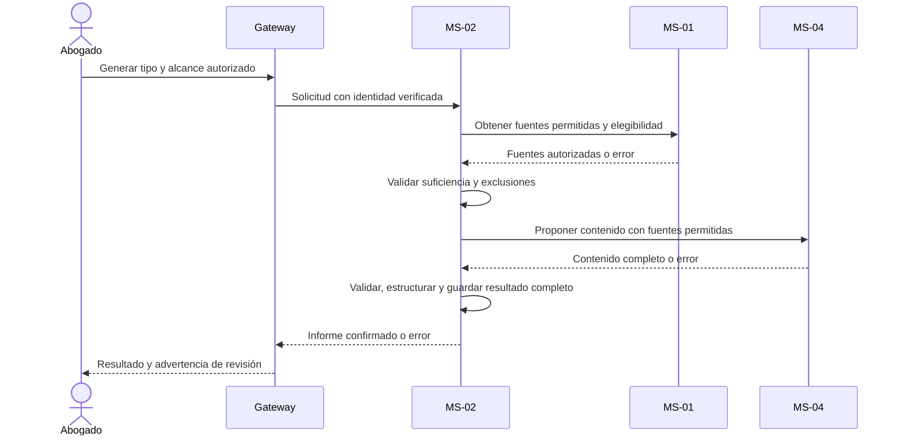

# Plan: Informes jurídicos

## Estado

Completa. Plan aprobado por el responsable el 2026-11-08; implementación y verificación local de T01–T04 y C01–C14 completadas el 2026-11-10. Ver [registro de ejecución](./tasks.md). Sin commit ni push de esta entrega.

## Resumen técnico

MS-02 coordina fuentes jurídicas autorizadas de MS-01 y contenido propuesto por MS-04; estructura, guarda y presenta el informe únicamente cuando el resultado está completo. Metadatos en `documental` y contenido en el almacenamiento propio de MS-02.

Aplicar principios II, IV, X y XI de la [constitución](../../docs/constitution.md). Informes guardados son una entidad separada, nunca documentos o fuentes de nuevos informes/IA. No añadir edición, eliminación, aprobación obligatoria o formatos múltiples sin confirmación.

## Diseño y componentes

- Ampliación de 005 (2026-11-10): MS-04 incorpora la biblioteca del agente después de verificar exactamente las fuentes CASE/PDF recibidas. Devuelve un manifiesto `lawSources` sin texto; MS-02 valida tipo LAW, UUID, nombre y ausencia de duplicados antes de autorizar referencias y guardar/renderizar el resultado. El cliente no aporta leyes ni manifiestos. Informe natural real con fuente CASE+LAW, PDF descargable e independencia de retirada posterior verificados; evidencia en [005](../005-configuracion-de-agentes/tasks.md).
- Informe guardado inmutable: cuenta, un expediente, tipo, fecha y PDF completado; sin edición ni eliminación.
- Casos de uso generar, listar/consultar, descargar y exportar resultado tabular; puertos de fuentes, generación IA, almacenamiento y metadatos.
- Tipos: resumen ejecutivo de una página, informe para cliente en lenguaje claro y reporte por consulta natural con filtros autorizados.
- React: tipo/expediente Abierto o Cerrado, consulta cuando corresponda, resultado, aviso de revisión e histórico. No flujo de aprobación ni envío al cliente. Archivado solo consulta/descarga; aplicar [001](../001-experiencia-y-ui-compartida/plan.md).
- Para cliente, proyección cerrada desde MS-01: ficha básica jurídica, nombres/roles de participantes y actuaciones; sin documentos, notas/estrategia, identificaciones o contacto. No pedir al modelo eliminar información privada ya recibida.

## Flujo de datos

### Robustez y secuencia de generación

Frontera: React/GraphQL. Control: caso de uso MS-02. Entidades: fuentes jurídicas autorizadas e Informe guardado; MS-04 propone contenido, no persiste el informe.

Cada paso posterior se ejecuta solo si el anterior fue válido. Fuentes insuficientes, fallo de MS-01/MS-04 o contenido inválido no producen un informe completado.

MS-02 guarda binario/contenido y metadatos con la consistencia local definida en [010](../010-documentos-y-fotografias/plan.md): restos de escritura no se publican y se limpian de forma acotada. No hay transacción entre MS-01, MS-04 y MS-02.

La descarga/exportación lee el resultado guardado; no regenera contenido ni usa informes anteriores como fuentes.

Usar agente inicial vigente si habilitado; si no, pedir alternativa explícita habilitada. Presupuesto IA total de 60 segundos de 002. Todas las variantes excluyen notas e imágenes; resumen/reporte natural pueden usar texto PDF autorizado, sin OCR.

## Interfaces y contratos

- GraphQL para generación, histórico, descarga PDF y CSV como Base64 conforme a [002](../002-gateway-y-contratos-base/plan.md).
- REST MS-01 para proyecciones de fuentes permitidas y estado/pertenencia; separar expresamente la proyección para cliente.
- REST MS-04 con agente según política acordada, OpenAI y herramientas internas permitidas, fuentes explícitas y resultado completo; sin MCP ni lectura libre de informes.
- REST MS-02 para informes guardados completos que consume [013](../013-expedientes-offline/plan.md); incluir fecha y contenido descargable autorizado.
- Resultado tabular debe tener columnas y valores tipados para CSV; no convertir texto narrativo arbitrario en tabla silenciosamente.

CSV compartido con 016: UTF-8, punto y coma, cabeceras, comillas/saltos escapados, fechas dd/MM/yyyy e importes sin miles y con coma decimal. Neutralizar textos interpretables como fórmulas al exportar a hojas de cálculo mediante escape documentado, nunca ejecutar contenido ni cambiarlo silenciosamente; comprobar la representación con el desarrollador.

Renderizar resumen a PDF y comprobar una página real; ajustar generación dentro del presupuesto o rechazar con error explícito si no puede cumplir, sin truncar contenido ni guardar como completado un PDF inválido.

## Persistencia y migraciones

Entidad y metadatos propios de informes en `documental`; almacenamiento de contenido de MS-02 según [ADR 0003](../../docs/decisions/0003-persistencia-por-servicio.md). Reutilizar herramienta de migraciones y puerto de archivos acordados en 010.

Separar tablas/listados de documentos y fuentes. Registrar fecha/tipo y solo publicar completados. No crear copias del expediente ni almacenamiento de informes en MS-04.

Solo un expediente por informe; no mutaciones de edición/eliminación ni fuentes multiexpediente. Guardar PDF y tabla estructurada cuando exista, evitando regenerarla para CSV.

## Seguridad y privacidad

Solo Abogado propietario genera, consulta y descarga. Administrador y otras cuentas rechazados, incluso por enlace directo.

Excluir notas de toda IA y estrategia de actuaciones según 009. La lista permitida para cliente excluye también PDF, identificaciones y contacto; no basar privacidad en una instrucción probabilística al modelo.

Aprobar privacidad del proveedor conforme a 011; sin logs de fuentes o informes. Aviso de revisión no autoriza divulgar datos internos.

## Observabilidad y manejo de errores

Registrar fase técnica y categoría segura, no contenido generado. Errores de fuentes, proveedor, estructuración o persistencia llegan al usuario sin éxito ni informe parcial disponible.

Pérdida de respuesta final puede dejar un informe guardado: no afirmar que no se creó. La spec/contrato debe permitir consultar el resultado o acordar repetición segura sin regenerar automáticamente.

## Verificación

El desarrollador comprueba resultados y flujos, sin crear archivos de testing ni documentos adicionales.

| Criterio de la spec | Comprobación |
|---|---|
| 1. Resumen | Con fuentes suficientes: guardado con fecha/tipo y presentado; renderizar en formato aprobado y comprobar exactamente una página. |
| 2. Sin notas | Incluir notas privadas identificables en el expediente: ausentes de fuentes para cliente y resultado final. |
| 3. Revisión | Informe para cliente muestra aviso/flujo aprobado de revisión profesional. |
| 4. Reporte autorizado | Consulta natural usa solo fuentes/filtros aprobados de su cuenta; no identificadores ajenos. |
| 5. Fuentes/fallos | Fuentes insuficientes y MS-01/MS-04 caídos: error y ningún informe completado; incluir falla de persistencia MS-02. |
| 6. Histórico/descarga | Fecha/tipo correctos y descarga íntegra del formato aprobado. |
| 7. Sin realimentación | Informe previo no aparece en fuentes, herramientas o contexto de otro informe/chat. |
| 8. Entidad separada | Informe guardado no figura en documentos del expediente. |
| 9. CSV | Exportar tabla y volver a leerla: mismos campos/valores/filas, incluidos comillas, saltos, BOB y caracteres españoles. |
| 10. Otra cuenta | A consulta/descarga informe de B: rechazo sin contenido. |
| 11. Administrador | Consulta directa: no autorizado. |
| 12. Estado/formato | Archivado rechaza generación, pero descarga PDF previo. |
| 13. Una página | Renderizar resumen y contar exactamente una página, sin cortes ocultos. |
| 14. Inmutabilidad | Ninguna operación permite editar o eliminar informes guardados. |

La exclusión se concreta con las fuentes permitidas de la spec. Todas las verificaciones reales quedan a cargo del desarrollador, sin archivos de testing en este trabajo.

## Decisiones

- MS-02 coordina y conserva; MS-04 solo propone contenido. Reutilizar proveedor y almacenamiento existentes.
- PDF narrativo, fuentes de cliente y Base64 quedan acordados; usar renderizador mantenido compatible con MS-02 durante implementación, sin añadir formatos alternativos. Alcance mínimo en el [ADR 0004](../../docs/decisions/0004-integraciones-minimas-del-mvp.md).
- Convenciones CSV compartidas con 016, sin un servicio de exportación adicional.
- Renderizador mantenido `pdfkit` 0.20.2 y tipos 0.17.7, instalados con versiones exactas. PDF A4 con Helvetica y verificación de páginas antes de publicar; un resumen que excede una página se rechaza, no se reintenta ni recorta. Caracteres fuera de Latin-1/puntuación admitida producen error explícito; no se sustituyen glifos silenciosamente. Máximo 40 páginas y 10 MiB por PDF.
- V2 de MS-02 crea `documental.reports` separada de `files`; reutiliza migraciones con checksum y preparación explícita. PDF en subdirectorio `reports` del almacenamiento MS-02. STAGING nunca aparece en lecturas; COMPLETE conserva PDF, secciones, tabla tipada, fuentes y agente real. No guarda copia de fuentes ni contenido de informes en MS-04.
- `requestId` y huella de entrada se reservan antes de la propuesta. Repetir una solicitud completada devuelve el mismo resultado sin proveedor; distinta entrada o solicitud no confirmada exige consulta. La limpieza bloquea la fila y nunca elimina bytes de COMPLETE, incluso si se perdió la confirmación de publicación.
- Limpieza técnica individual mediante `REPORTS_CLEANUP=true` y UUID de informe: solo STAGING de más de 15 minutos. No es una operación del Abogado ni una eliminación de informes históricos. Fallos durante limpieza quedan no publicables, sin afirmar éxito.
- Fuentes suficientes: al menos un participante, una actuación filtrada o texto PDF autorizado. Filtros cerrados de tipo/fechas y hasta diez PDF explícitos, nunca para CLIENT. Exceso de fuentes/contexto falla sin truncamiento. MS-04 vuelve a consultar propietarios y exige igualdad del contexto recibido antes de llamar al proveedor.
- Captura vigente del agente y herramientas: `CASE_LEGAL_DATA` para la base jurídica, y `CASE_PDF_TEXT` cuando se eligieron PDF. OpenAI devuelve esquema JSON estricto con secciones obligatorias, tabla tipada y referencias limitadas al registro autorizado; no recibe herramientas libres, SQL ni comandos ejecutables. Rechazo/truncamiento/error no activa fallback ni reintento.
- CSV usa BOM UTF-8 y comillas en todos los campos. Cabeceras/textos potencialmente interpretables como fórmulas reciben un apóstrofo; un apóstrofo inicial se duplica para conservar reversibilidad. No altera la tabla original ni protege importes negativos como si fueran texto. Fechas/decimales coinciden con la tabla React/PDF.
- Contratos de 013: GET paginado `/cases/{caseId}/reports` como manifiesto de completados, detalle por ID y `/{id}/content`/`/{id}/csv` Base64. Incluyen fecha/tipo/agente; exigen propietario vigente también en Archivado. Esta entrega no implementa copia offline.

## Riesgos y preguntas abiertas

- Un aviso de revisión no garantiza calidad jurídica; se mantiene responsabilidad profesional y nunca se envía al cliente automáticamente.
- Fuente insuficiente, contexto excesivo o PDF que no cabe en una página produce error, no truncado ni informe completado falso.
- Sin preguntas funcionales abiertas; no se reintenta generación automáticamente tras resultado incierto.
- Verificación local con PostgreSQL/MongoDB externos y datos exclusivamente sintéticos; no acredita condiciones de tratamiento de datos reales por OpenAI, calidad jurídica ni disponibilidad de producción. El renderizador rechaza caracteres no representables y no incorpora OCR ni fuentes Unicode adicionales.