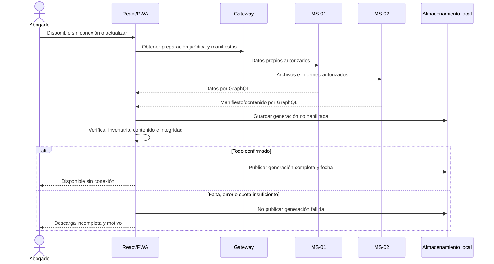

# Plan: Expedientes offline

## Estado

Lista. Plan aprobado por el responsable el 2026-11-08; implementación y verificación pendientes.

## Resumen técnico

La PWA React permite preparar copias íntegras para lectura sin conexión. MS-01 aporta datos jurídicos y MS-02 archivos/informes; una copia solo se publica como disponible después de verificar todo su contenido.

Aplicar principios II, IV, VI, X y XI de la [constitución](../../docs/constitution.md). No ERP, conversaciones, IA local, cambios pendientes, sincronización ni DynamoDB para copias.

## Diseño y componentes

- MS-01: caso de uso de preparación jurídica del expediente propio, incluyendo personas, participantes, actuaciones y notas.
- MS-02: contratos de manifiesto y lectura autorizada de documentos, fotografías e informes guardados.
- React: gestor de descargar/actualizar/eliminar, listado con estado y última fecha completa, y lector de todas las secciones.
- IndexedDB para datos/binarios/manifiesto cifrados por cuenta/expediente/generación. Service worker solo para recursos estáticos necesarios de Shell/React, sin cachear APIs privadas indiscriminadamente.
- Reutilizar [001](../001-experiencia-y-ui-compartida/plan.md) para indicador permanente y acciones bloqueadas. La eliminación de copia es una acción local del gestor, no escritura al servidor.
- Encapsular acceso local en un adaptador pequeño; no un motor de sincronización ni un almacén global reutilizable sin necesidad.

## Flujo de datos

### Robustez y secuencia de descarga

Frontera: React/PWA. Control: gestor de descarga y casos de uso propietarios. Entidad: Copia offline con manifiesto e integridad; los servicios conservan autoridad sobre sus datos.

Las respuestas representadas hacia React pasan por el Gateway; no son conexiones REST directas desde la PWA.

El manifiesto identifica todos los elementos esperados, incluida una lista vacía válida de informes. Comparar contenido recibido con inventario, tamaño/integridad según contrato y capacidad de lectura local. No basta que cada solicitud devuelva HTTP 200.

No prometer una instantánea atómica entre MS-01 y MS-02. Definir versiones o referencias estables para detectar cambios/faltantes durante la descarga; si no se puede completar el inventario confirmado, no habilitar la copia.

Conservar generación no publicada durante preparación y publicar su referencia completa atómicamente. Una actualización fallida conserva la completa anterior con su fecha y muestra el fallo aparte. Máximo 10 expedientes por dispositivo/perfil; actualizar uno no consume cupo adicional.

Offline lee exclusivamente la generación completa autorizada. Si un archivo se volvió inaccesible o la copia está corrupta/incompleta, informar que no es válida; no mostrarla como disponible.

Eliminar borra todos los datos/binarios de esa copia local y su manifiesto, previa confirmación, sin llamar a un borrado remoto. Volver online no inicia envíos de cambios ni actualización automática.

## Interfaces y contratos

- GraphQL para preparación, manifiestos y contenido mediante transporte de [002](../002-gateway-y-contratos-base/plan.md); REST entre propietarios cuando sea necesario.
- Manifiesto: cuenta/expediente autorizados, referencia de generación/versión, inventario de secciones/archivos e información de integridad. Aprobar nombres/tipos antes de integrar.
- Copia incluye ficha, personas, participantes, actuaciones, notas, documentos, fotografías e informes fecha/tipo; excluye ERP y chat estructuralmente.
- Contexto de conectividad hacia 001 distinto de indisponibilidad de un servicio. Una pérdida de red impide descarga/generación/escritura, no autoriza una sesión local automáticamente.
- Contexto local propio del Abogado descargador, desbloqueado con su contraseña de login, sin vencimiento temporal de copias. No reutilizarlo como sesión online de [003](../003-autenticacion-y-acceso/plan.md).

## Persistencia y migraciones

Solo almacenamiento del navegador de la cuenta/dispositivo; no nuevas tablas de negocio. Versionar esquema IndexedDB y manifiesto para reconocer copias incompatibles, sin convertirlas silenciosamente en completas.

Publicar estado completo y fecha después de guardar/verificar todos los datos; tratar cuota, evacuación de almacenamiento y fallos de apertura como errores explícitos. Una estimación de cuota previa no garantiza que la escritura final funcione.

No usar `localStorage` para binarios ni contenido privado. Cache estática y copias privadas tienen responsabilidades separadas; evitar limpiar caches/almacenes de aplicaciones ajenas.

Usar Web Crypto nativo: derivación de clave desde contraseña de login con sal aleatoria, parámetros versionados y cifrado autenticado AES-GCM con IV único por contenido. Incluir identidad de cuenta/expediente/generación en autenticación del cifrado. No criptografía casera, clave persistente descifrada ni contraseña guardada.

Desbloquear requiere la misma contraseña, no otra adicional. Mantener clave solo en memoria de la vista, limpiarla al salir y no enviarla al service worker. Si cambia/restablece la contraseña y una copia ya no abre, informar y ofrecer eliminar/descargar otra vez, no migración ni recuperación automática. Un intento incorrecto no borra copias.

## Seguridad y privacidad

Solo descargar expedientes de la cuenta autenticada y acceder a las copias de esa cuenta conforme a la política local aprobada. Notas privadas están incluidas únicamente para su propietario.

Sin red no se detecta suspensión y se acepta acceso sin vencimiento. Al conocer suspensión online, bloquear y borrar copias. Cerrar sesión o entrar otra cuenta elimina copias anteriores y claves; no existe bóveda multicuenta.

Salir de la consulta sin red limpia datos/claves locales, pero no puede afirmar invalidación de sesión servidor sin respuesta online. Distinguir esa salida local del logout efectivo de 003; no crear una cola de operaciones para fingirlo.

La PWA debe operar en contexto seguro compatible con service worker. No registrar contenido local ni exponer datos por caches públicas.

## Observabilidad y manejo de errores

Estado visible de descarga, motivo de incompletitud y fecha de última descarga completa. Un error nunca habilita una nueva copia ni borra silenciosamente el indicador de antigüedad.

Tratar fallos de red, recursos ausentes, cuota, integridad y lectura local de forma diferenciada y segura. No registrar documentos/notas ni añadir telemetría que los envíe.

## Verificación

Responsabilidad del desarrollador, sin crear archivos de testing. Referencia: Chrome/Edge escritorio, Chrome Android y Safari iPhone/iPad estables con APIs requeridas. El desarrollador comprobará recarga/arranque sin red, cifrado, cuota e integridad; no se ejecutan esas pruebas en este trabajo documental.

| Criterio de la spec | Comprobación |
|---|---|
| 1. Descarga por estado | Abierto, Cerrado y Archivado propios: copia completa y fecha visibles. Probar varios expedientes. |
| 2. Contenido | Comparar inventario y datos/binarios locales con servidor: todas las secciones requeridas; ningún ERP/chat. |
| 3. Sin informes | Lista de informes vacía válida: descarga completa. |
| 4. Recurso fallido | Fallar documento o informe: generación incompleta no habilitada. |
| 5. Cuota | Limitar espacio disponible: motivo explícito y copia no habilitada. |
| 6. Lectura offline | Cortar red, recargar/abrir PWA y consultar todas las secciones e informes. Archivo ausente/corrupto produce error, no copia válida. |
| 7. Sin operaciones online | Sin red, no escritura/adjuntos/chat/generación ni solicitudes diferidas. |
| 8. Solo lectura | Copias de Cerrado/Archivado también únicamente consultables. |
| 9. Actualizar | Cambiar servidor y actualizar: nuevo contenido/fecha; si falla, conservar anterior completa con fecha original y fallo aparte. |
| 10. Eliminar local | Confirmar: todos los datos/binarios de esa copia desaparecen; expediente remoto intacto. |
| 11. Reconectar | Volver online: ninguna sincronización o envío de cambios. |
| 12. Cupo | Con 10 copias completas, otra se rechaza; actualizar existente sigue permitido. |
| 13. Actualización fallida | Generación anterior continúa íntegra y la fallida nunca se publica. |
| 14. Cifrado | Contraseña de login correcta desbloquea sin otra; no secreto/clave en almacenamiento persistente. |
| 15. Sesión/cuenta/suspensión | Borrar copias y claves en casos acordados, sin prometer revocación sin red. |
| 16. Cambio de contraseña | Informar copia inaccesible, permitir borrado y nueva descarga, sin alterar servidor. |

Comprobar aislamiento de dos cuentas en el mismo dispositivo y políticas aprobadas de sesión/cifrado. La verificación de descarga necesita 010 y 012; registrar pendientes en tareas.

## Decisiones

- IndexedDB cifrado y service worker solo para base estática, sin librería offline amplia.
- Cifrado con contraseña de login, sin vigencia temporal ni segunda contraseña, y limpieza de copias constan en el [ADR 0004](../../docs/decisions/0004-integraciones-minimas-del-mvp.md).
- Transporte binario reutiliza 002; gestión de archivos/informes reutiliza 010/012, no duplica sus repositorios.

## Riesgos y preguntas abiertas

- La fortaleza del cifrado depende de la contraseña de login; no se garantiza seguridad de producción o de un navegador comprometido.
- No hay revocación remota sin red ni recuperación de clave: al cambiar contraseña pueden requerirse nuevas descargas.
- Límite 10 y cuota no garantizan espacio; la copia anterior se conserva ante fallo.
- Acordar manifiestos y estabilidad de fuentes sin una transacción distribuida.
- Almacenamiento del navegador puede evacuarse; verificar cada copia al abrir y comunicar pérdida.
- Sin preguntas funcionales abiertas; la comprobación queda anotada como responsabilidad del desarrollador.