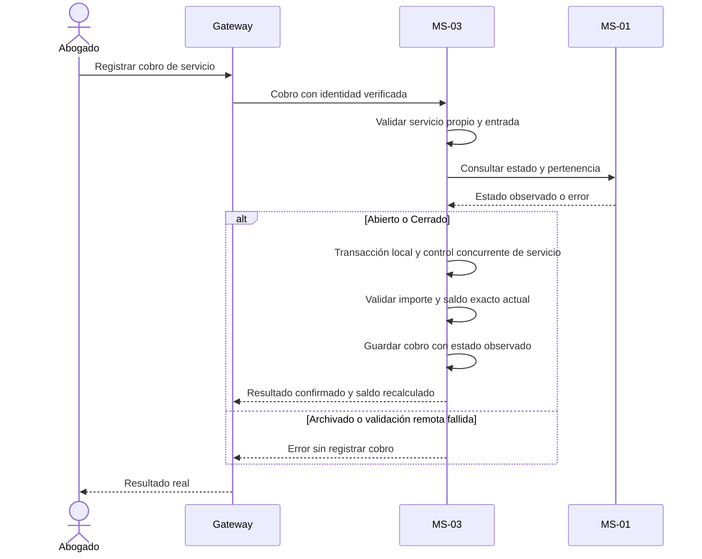

# Plan: Cobros y gastos

## Estado

Lista. Plan aprobado por el responsable el 2026-11-08; implementación y verificación pendientes.

## Resumen técnico

MS-03 registra cobros por servicio y gastos por expediente en PostgreSQL `erp`. Consulta MS-01 al solicitar registro/corrección y conserva el estado observado. El saldo se calcula como honorarios menos cobros efectivos, sin restar gastos.

Aplicar principios II, IV, X y XI de la [constitución](../../docs/constitution.md). No pagos electrónicos, documentos fiscales, anulación no aprobada ni atomicidad entre MS-01/MS-03.

## Diseño y componentes

- Cobro: cuenta, servicio, importe BOB positivo, fecha, medio Efectivo/Transferencia/Tarjeta/Otro y estado observado.
- Gasto: cuenta, expediente, concepto, categoría Tasas y aranceles/Trámites y documentación/Transporte/Otro, fecha, importe BOB positivo y estado observado.
- Casos de uso registrar/corregir/consultar cobros y gastos; historial de correcciones con anterior, fecha y autor.
- Reutilizar servicios de [014](../014-servicios-y-honorarios/plan.md), validación/aritmética monetaria exacta y control concurrente por servicio.
- React: formulario/historial de cobros con saldo; gastos separados y filtros por categoría/rango de fechas. Aplicar [001](../001-experiencia-y-ui-compartida/plan.md), sin alertas/detección de duplicados.

## Flujo de datos

### Robustez y secuencia de cobro

Frontera: React/GraphQL. Control: caso de uso de cobro MS-03. Entidades: Servicio, Cobro e historial; MS-01 aporta estado/pertenencia.

No mantener la transacción de MS-03 abierta durante una llamada remota. El estado guardado es el que devolvió MS-01 al solicitar la operación, aunque cambie concurrentemente; esta limitación está expresamente prevista por la spec.

Dentro de la transacción local, serializar cobros/correcciones y cambios económicos por servicio para que dos cobros ordinarios simultáneos no superen el saldo. Un gasto no afecta honorarios/saldo y se guarda con su propio estado observado.

Corregir valida estado actual Abierto/Cerrado y reglas aprobadas, conserva anterior/fecha/autor y recalcula saldo a partir de valores efectivos. No sumar simultáneamente original y corrección como dos cobros.

## Interfaces y contratos

- GraphQL/REST para cobros, gastos, correcciones, filtros e historial/saldo conforme a [002](../002-gateway-y-contratos-base/plan.md).
- REST MS-01 para estado/pertenencia; identidad de cuenta verificada, sin consultas SQL cruzadas.
- Medios, categorías y filtros cerrados en la spec. Correcciones de cobro también respetan saldo efectivo, sin contar dos veces original/revisión.
- No deduplicación funcional ni claves de idempotencia para movimientos: iguales datos pueden registrarse otra vez si válidos. UI bloquea envío mientras esté pendiente, pero eso no garantiza ejecución única.
- Todos los cobros son ordinarios y no superan saldo, sin anticipos/excepciones. Cobros/gastos estrictamente positivos, máximo dos decimales.
- Sin anulación ni eliminación; solo correcciones trazables.

## Persistencia y migraciones

Tablas de cobros, gastos e historial en `erp`; usar migraciones Laravel propuestas en 014. Referencias locales al servicio y contractuales al expediente/cuenta.

Guardar estado observado con cada movimiento; no reemplazarlo por el estado actual al consultar. Conservar información de observación/corrección necesaria sin borrar el registro anterior.

Usar precisión monetaria exacta aprobada en 014/002. Saldo derivado de honorarios y cobros efectivos; si se materializa por necesidad demostrada, actualizarlo en la misma transacción, no con tareas asíncronas.

No crear restricciones únicas por campos de movimiento ni tabla de idempotencia. La única identidad técnica es la de cada registro; dos envíos nuevos son dos movimientos válidos si cumplen reglas.

## Seguridad y privacidad

MS-03 exige Abogado propietario y valida servicio/expediente; Administrador y otras cuentas no acceden. No aceptar cuenta del cuerpo como autoridad.

No registrar movimientos, medios de pago o valores privados en errores/logs. El acceso al historial mantiene aislamiento aunque el expediente esté Archivado.

## Observabilidad y manejo de errores

Importe inválido y sobrepago producen rechazo explícito según 002; duplicidad no es error en esta fase. Si MS-01 no responde, no guardar ni informar éxito.

Fallo local revierte movimiento/historial. Si se pierde respuesta tras guardar, comunicar incertidumbre y pedir revisar historial antes de otro envío: no hay deduplicación ni garantía de ejecución única. Nunca repetir cobros automáticamente.

## Verificación

El desarrollador verifica sin crear archivos de testing; comprobar cálculos exactos, concurrencia y API directa.

| Criterio de la spec | Comprobación |
|---|---|
| 1. Cobro parcial | En Abierto/Cerrado: importe guardado, estado observado y reducción exacta del saldo. |
| 2. Cobro total | Importe igual a pendiente: saldo exactamente cero. |
| 3. Sobrepago | Cobro ordinario mayor a saldo por API: rechazo; probar dos cobros concurrentes que juntos excederían saldo. |
| 4. Importe inválido | Cero/negativo/más de dos decimales rechazados, sin redondear. |
| 5. Gasto | Abierto/Cerrado: gasto con estado observado; honorarios y saldo sin cambios. |
| 6. Archivado | Registro/corrección de ambos tipos: rechazo. |
| 7. MS-01 caído | Ambos registros rechazados sin éxito; comprobar también correcciones. |
| 8. Corrección | Nuevo efectivo visible y anterior/fecha/autor conservados; saldo coherente sin contar dos veces. |
| 9. Consulta | Historial y saldos consultables en los tres estados; filtros de gasto correctos. |
| 10. Otra cuenta | A consulta/registra sobre datos de B: rechazo. |
| 11. Administrador | Consulta directa: no autorizado. |
| 12. Iguales datos | Dos cobros que caben en saldo y dos gastos iguales se permiten; no detección, aviso o claves de idempotencia. |
| 13. Filtros | Categoría y rango de fechas devuelven solo gastos coincidentes. |
| 14. Operaciones limitadas | No anular/eliminar movimientos; correcciones preservan historial. |

El desarrollador comprobará cambio de estado concurrente y conservación del observado, sin atomicidad global. Catálogos y duplicidad ya están resueltos; no se ejecutan pruebas en este trabajo documental.

## Decisiones

- Reutilizar transacciones locales, migraciones y aritmética de 014; no plataforma de pagos.
- No implementar idempotencia/deduplicación de movimientos por decisión explícita del usuario; conservar validación de saldo, estado, identidad y precisión.

## Riesgos y preguntas abiertas

- Un reenvío manual puede registrar otro movimiento si aún es válido; esa limitación se comunica y no se oculta con éxito ficticio.
- Sin preguntas funcionales abiertas. El desarrollador verifica cálculos/concurrencia.